# Attention Orchestration Platform: Architecture

*Status as of 2026-11-07, branch `feature/attention-models`, after Milestone 33. Sections 3, 5, 12, 13, 14, 19 and 22 and the terminology table in section 4 are current. The flows, contracts and diagrams in sections 6 to 11 and 15 to 18 describe the original pipeline; later milestones extended them and the milestone documents are the detailed record, so check a milestone document before relying on a detail there.*
*Scope of this document: the Go backend (`go-server/notification-service`) and the web console (`apps/web`), with the Java service and the deployment files described where they touch them.*

> **Notifications are cheap. Human attention is expensive.**
> The platform decides *whether, when, where and how* a person should be interrupted. Providers such as Novu only deliver.

**Contents**

1. [Purpose and Scope](#1-purpose-and-scope)
2. [Source Documents and References](#2-source-documents-and-references)
3. [Executive Summary](#3-executive-summary)
4. [Terminology Reconciliation](#4-terminology-reconciliation)
5. [Feature Inventory](#5-feature-inventory)
6. [Feature Architecture](#6-feature-architecture)
7. [Definition Model](#7-definition-model)
8. [System Architecture](#8-system-architecture)
9. [Component Inventory](#9-component-inventory)
10. [End-to-End Flows](#10-end-to-end-flows)
11. [The Data Contracts](#11-the-data-contracts)
12. [What Has Been Delivered](#12-what-has-been-delivered)
13. [Forward Roadmap](#13-forward-roadmap)
14. [Architecture Delta Summary](#14-architecture-delta-summary)
15. [ER Diagram](#15--er-diagram-entity-relationship)
16. [UML: Key Class Relationships](#16--uml--key-class-relationships)
17. [Pipeline Lifecycle: State Machine](#17--pipeline-lifecycle--state-machine)
18. [Design Patterns Used](#18--design-patterns-used)
19. [Key API Endpoints](#19--key-api-endpoints)
20. [Cross-Cutting Concerns](#20-cross-cutting-concerns)
21. [Guidance Per Role](#21-guidance-per-role)
22. [Status-at-a-Glance](#22-status-at-a-glance)
23. [Change Record](#23-change-record)

---

## 1. Purpose and Scope

This is the single architecture reference for the Go backend of the Attention Orchestration Platform. It answers four questions:

1. What is the system *meant* to be (the product model)?
2. What *actually exists* in the code today?
3. Where do the documents, the plan and the code disagree?
4. What gets built next, and in what order?

It is written to be checked against the code. Every component, route, table and environment variable named here exists on `feature-impl` unless it is explicitly marked **planned**.

**In scope:** the Go service, its data model, its interfaces and its operating model.
**Out of scope:** AI model design (Layer 2 is not built yet), the Java service internals (not reviewed), and commercial/SaaS concerns.

### 1.1 The 30-second mental model

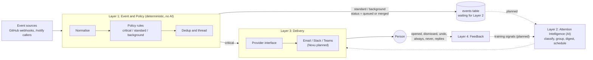

Solid arrows exist today. Dashed arrows are planned. The one rule that never bends: **critical events never touch AI and are never merged or suppressed.**

### 1.2 System context

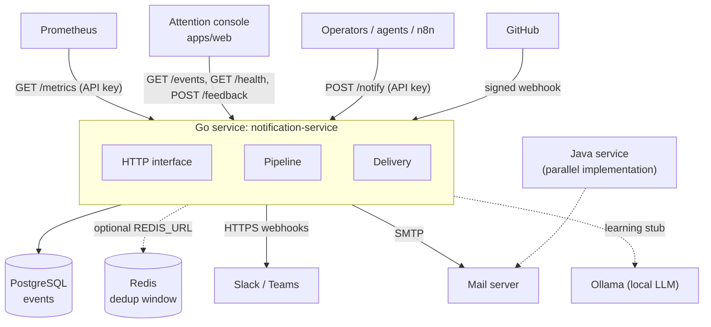

---

## 2. Source Documents and References

Related: [ui-architecture.md](ui-architecture.md), [deployment.md](deployment.md) and [notification-hubs-comparison.md](notification-hubs-comparison.md).

| Document | What it is | Reliability today |
|---|---|---|
| [`AGENTS.md`](../AGENTS.md) | Project charter: layers, rules, tech stack, the 10-milestone plan | Authoritative for intent. Milestone *numbers* no longer match the implemented milestones (see section 3) |
| [`docs/orchestration-platform.md`](orchestration-platform.md) | Earlier architecture overview and implementation status | Refreshed in milestone 33; this document is the current reference |
| [`docs/project vision.md`](<project vision.md>) | Enhanced product vision: timeline, smart rules, MCP server, SDK, dashboard, agent registry, replay | Aspirational. Almost none of it is built |
| [`docs/agentpulse.md`](agentpulse.md) | Earlier product framing ("AgentPulse") | Historical |
| [`docs/extrat of what we wnted to see.md`](<extrat of what we wnted to see.md>) | Working notes | Historical |
| [`docs/milestones/milestone-1.md` ... `milestones/milestone-13.md`](milestones/milestone-13.md) | Per-milestone goals, decisions, tests, acceptance | Accurate for what each milestone delivered |
| [`docs/rules/coding-standards.md`](rules/coding-standards.md) | Enforced and review-time standards | Accurate; items marked `[Gap]` are tracked |
| [`docs/runbook.md`](runbook.md) | Operating the service: symptoms, causes, actions | Accurate as of step 6 |
| [`docs/frontend.md`](frontend.md) | The console: design language, states, copy rules, structure | Accurate |
| [`docs/milestones/milestone-14.md`](milestones/milestone-14.md) | Operator console and read API | Accurate |
| [`docs/CHANGELOG.md`](CHANGELOG.md) | Running index of every change | Accurate |
| [`roadmap.md`](../roadmap.md) | Outline of roadmap headings | Skeleton only |
| [`skills/`](../skills/README.md) | `golang-pro` and `tarun-code-review` guides | Used for the Milestone 13 review |

**External references cited by the project:** Novu design guide (digests, multi-channel), Apple notification summaries, Horvitz et al. (intelligent notification platform), MagicBell UI patterns.

---

## 3. Executive Summary

### The consolidated feature model

The product is **four layers around one invariant**.

| Layer | Job | Technology | AI allowed |
|---|---|---|---|
| **1. Event and Policy** | Ingest, normalise, validate, classify by rule and payload predicate, deduplicate, thread, apply preferences, overrides and the attention budget | Go, YAML and API-edited rules, PostgreSQL, Redis (optional) | **Never** |
| **2. Attention Intelligence** | Classify standard events, summarise held events into digests, explain decisions, suggest rule changes from feedback | A deterministic heuristic by default; optionally Ollama or Claude behind the same interfaces, with the heuristic as the fallback | Only here |
| **3. Delivery** | Send through channels behind an abstraction | SMTP, Novu (optional, email), Slack and Teams webhooks, SMS (mock, HTTP or SNS), a durable retry queue | No |
| **4. Feedback** | Capture opened, dismissed, undo, always, never, replies; store them; turn "always" and "never" into visible, reversible overrides | Go, PostgreSQL | No |

**The invariant, "never suppress" bucket:** security alerts, P1 incidents, payment failures and outages are `critical`. They skip Layer 2 entirely, are never merged by deduplication, are never muted, delayed, budgeted, deferred to a worker or changed by a suggestion, and are delivered synchronously, to every configured channel, before being recorded. An AI agent reporting its own step cannot make that step critical: only a rule decides the class. Each milestone from 25 on carries tests that pin this.

### What exists (as of Milestone 33)

- **Ingestion:** GitHub webhooks (HMAC, replay-safe IDs) and agent events (`POST /api/events`), both through the same pipeline; `/notify` for direct messages; an MCP server over stdio and `POST /api/mcp`.
- **Layer 1:** rules edited at run time (conditions on source, type, repository and payload predicates; optional per-rule channels; locked critical rules; strict YAML), deduplication and threading (in process or Redis; agent runs are one thread), quiet hours and mutes, always and never overrides, a rolling attention budget, an asynchronous worker that can take the attention step off the ingest path and release events held for quiet hours.
- **Layer 2:** heuristic classifier, digests (workspace-wide and per person), plain-language explanations, a learning engine that turns stored feedback into reviewable suggestions, optional Ollama and Claude adapters with a circuit breaker, a rate cap, redaction and strict validation of answers.
- **Layer 3:** a durable delivery queue with retries and dead letters, email through SMTP or Novu, Slack and Teams, SMS, strict STARTTLS option.
- **Layer 4:** stored, attributed feedback; overrides; audit trail.
- **Accounts:** argon2id passwords, server-side sessions, CSRF, roles, sign-in lock-out, generic OpenID Connect with an Entra ID shortcut; the API key still works for services.
- **Reading:** an inbox with state, filters and bulk actions, all notifications, activity, analytics, traces, digests, explanations, live updates, cursor pagination.
- **The console** (`apps/web`, React and TypeScript): 15 screens including Traces, five colour themes, nine languages (the newest screens are English only), and a complete demo mode that powers the hosted site.
- **Operations:** Prometheus metrics, structured logs with request IDs, `traceparent` propagation and span logs, retention, graceful shutdown, Docker Compose, Kubernetes manifests, GitHub Pages and GHCR workflows.
- **Size:** 33 Go packages and two commands, 677 Go test functions and 230 Vitest tests (counts from the last local run).

### What is not as complete as it looks

1. **Several parts have only run against fakes.** The PostgreSQL stores added in milestones 22 to 32, the Redis budget script, the Ollama and Claude adapters, Novu, SNS, OpenID Connect and the MCP server were tested against in-memory stores, local fake servers or recorded shapes. The PostgreSQL and Redis parts are exercised by integration tests that run only in CI, where they passed (section 12.2). What remains unproven is everything that needs a real third-party service: Ollama, Claude, Novu, SNS, an OpenID provider and a real MCP client.
2. **NATS is not used.** It is named in the intended stack (`AGENTS.md`) but is not in the Compose file and nothing publishes or consumes. The asynchronous worker polls a PostgreSQL queue; delivery polls too.
3. **A second implementation exists.** `java-server/` is a parallel notification service that this work did not review, and its CI job failed. **Decision (project owner): it is being implemented to the same standard as the Go service**, milestone by milestone. Milestone 34 built the core (rules, dedup, critical delivery, PostgreSQL persistence in the Go schema) and a shared HTTP contract (`docs/contract`); the rest follows.
4. **Delivery targets are workspace-wide.** Personal digests are stored and readable in the app but not delivered to a person, because jobs deliberately hold no address.
5. **Tracing is context propagation and span logs**, not an OpenTelemetry exporter.
6. **Learning is advisory.** It proposes rule and override changes; an admin applies them. Nothing changes silently.
7. **Newer console screens are English only**, and have no fields yet for rule predicates, per-rule channels or personal preferences (API only).
8. **Two overlapping send paths remain:** `POST /notify` and the event pipeline.

### What comes next

Run everything against the real services it was written for (PostgreSQL, Redis, Ollama, Claude, Novu, SNS, an OpenID provider, a real MCP client), per-person delivery, NATS or another queue if polling stops being enough, and the SaaS concerns (tenancy, billing). Section 13 lists them.


---

## 4. Terminology Reconciliation

The documents use several words for the same idea, and one word for several ideas. This is the canonical vocabulary used in this document.

| Canonical term | Also seen as | Meaning | In code |
|---|---|---|---|
| **Event** | notification, alert, signal | A normalised thing that happened in a source system | `event.Event` |
| **Attention class** | notification class, priority bucket, criticality | `critical`, `standard`, `background` | `Event.AttentionClass`, `event.Attention*` |
| **Never-suppress bucket** | critical path, bypass | The `critical` class and the guarantees attached to it | `pipeline.Handle` critical branch |
| **Decision state** | decision status, outcome | What the system decided for an event: status, reason, matched rule, confidence | `event.DecisionState` |
| **Decision status** | state, lifecycle | `sent`, `queued`, `merged`, `digest`, `delayed`, `budget_exceeded` (all assigned since milestone 25 to 29) | `event.Decision*` |
| **Policy rule** | smart rule, routing rule | A YAML condition (source, type, repository) mapped to an attention class | `policy.Rule` |
| **Policy engine** | rule engine | First-match evaluator of rules | `policy.Engine` |
| **Dedup key** | merge key | Fingerprint of "the same thing again" | `dedup.DedupKey` |
| **Thread** | group, conversation | Events about one subject (a PR, an issue) | `Event.ThreadID` |
| **Pipeline** | orchestrator, flow | The ordered Layer 1 flow plus delivery and persistence | `pipeline.Pipeline` |
| **Provider** | channel, connector, vendor | An implementation that delivers a message | `delivery.Provider` |
| **Channel** | | A medium: email, Slack, Teams, SMS | provider-specific |
| **Delivery** | send, dispatch | Calling providers to reach a person | `delivery.Service` |
| **Feedback** | signal, label | A user's reaction to a notification | `feedback.EventFeedback` |
| **Attention budget** | interruption budget | A rolling cap on standard interruptions per workspace (`ATTENTION_BUDGET_PER_HOUR`); events over it are held for the next digest, never dropped | `pkg/budget` |
| **Digest** | summary, roll-up | One message summarising held events, workspace-wide or per person | `pkg/attention` |
| **Agent** | (1) the sender in `/notify`, (2) AI agents in the vision docs, (3) "Layer 2" | In `/notify`, `agent` identifies the caller (`AgentInfo`). It is *not* the AI layer | `notification.AgentInfo` |
| **Attention Layer / Layer 2** | AI layer, intelligence | The only place judgement (as opposed to a rule) lives: classification, digests, explanations, suggestions. Optional models sit behind the same interfaces as the heuristic | `pkg/attention`, `pkg/attention/llm`, `pkg/learning` |
| **Console** | dashboard, web app, UI | The operator-facing web app that shows decisions and takes feedback | `apps/web` |
| **Ledger** | event list, timeline | The console list; row size follows attention class | `components/Ledger.tsx` |
| **Flag** | badge, pill | Shape and colour marking a class (pennant, square, outline) or a merge (swallowtail) | `components/Flag.tsx` |
| **Replay / redelivery** | retry | GitHub resending the same delivery ID | `pipeline.ErrDuplicateDelivery` |
| **Suppression vs budget** | | Suppression hides an event; budget defers it. Critical is never subject to either | design rule |

---

## 5. Feature Inventory

Status: **Done** (built, tested), **Partial** (built, with a known gap), **Planned** (designed, not built), **Not planned** (in a vision document only).

| # | Feature | Layer | Status | Where | Notes |
|---|---|---|---|---|---|
| 1 | GitHub webhook ingestion | 1 | Done | `server/handlers.go` | Any GitHub event type; payload stored as JSONB |
| 2 | Webhook signature verification | 1 | Done | `server/webhook_auth.go` | HMAC-SHA256, constant time, fail closed |
| 3 | Event normalisation | 1 | Done | `normalizeGitHubEvent` | GitHub only; ID embeds the delivery ID |
| 4 | Redelivery idempotency | 1 | Done | `pipeline`, `event.Exists` | `200 duplicate`, nothing re-sent |
| 5 | Policy rules from YAML | 1 | Done | `policy` | Source, event type, repository; first match wins |
| 6 | Attention classes | 1 | Done | `event`, `policy` | Unknown classes rejected at load |
| 7 | Deduplication | 1 | Done | `dedup` | Memory or Redis; window `DEDUP_WINDOW` |
| 8 | Threading | 1 | Done | `dedup.ThreadID` | By repo and PR/issue number |
| 9 | Grouping (many events into one) | 1/2 | Done | `pkg/attention` | Threads, and digests that group held events by repository and source |
| 10 | Persistence and retention | 1 | Done | `event`, `db` | PostgreSQL, 90 days default |
| 11 | Critical delivery, never merged | 1/3 | Done | `pipeline` | Synchronous, all channels concurrent |
| 12 | Email delivery (SMTP) | 3 | Done | `delivery.SMTPProvider`, `mail` | STARTTLS when offered |
| 13 | Slack and Teams delivery | 3 | Done | `delivery.WebhookProvider` | https and allow-list; private IPs blocked |
| 14 | SMS delivery | 3 | Done | `pkg/sms`, `delivery.SMSProvider` | Mock, HTTP and Amazon SNS gateways; daily cap |
| 15 | Novu provider | 3 | Done | `delivery/novu.go` | Email, with SMTP as the fallback; not run against the real service |
| 16 | Agent `/notify` API | 3 | Done | `server`, `notification` | Validated, authenticated |
| 17 | Feedback capture | 4 | Done | `pkg/feedback` | Stored, attributed, validated against the event |
| 18 | Overrides (always/never notify) | 4 | Done | `pkg/overrides` | Visible and reversible; never apply to critical events |
| 19 | Preference storage | 4 | Done | `pkg/preferences` | Workspace and per person; quiet hours and mutes |
| 20 | AI classification of standard events | 2 | Done | `pkg/attention`, `pkg/attention/llm` | Heuristic by default; Ollama or Claude optional with fallback; models not run against the real services |
| 21 | Digest generation | 2 | Done | `pkg/attention` | Workspace and per person; stored; the workspace one can be delivered |
| 22 | Scheduling and attention budget | 2 | Done | `pkg/budget`, `attention.Worker` | Rolling budget; quiet-hours release; async worker (opt in) |
| 23 | Learning from feedback | 2 | Done | `pkg/learning` | Reviewable suggestions; an admin applies them; never touches critical or locked rules |
| 24 | Natural-language explanation | 2 | Done | `GET /api/explain/{id}` | Templated sentences; a model may reword them, labelled |
| 25 | Metrics and latency histograms | ops | Done | `metrics` | Prometheus text, per route |
| 26 | Structured logs and request IDs | ops | Done | `server/requestid.go` | JSON, `request_id` |
| 27 | Distributed tracing | ops | Partial | `pkg/telemetry` | `traceparent` and span logs; no collector export |
| 28 | Event read API | UI | Done | `server` | `GET /events` and `GET /api/notifications` with cursor pagination |
| 30 | MCP server and SDK | integration | Done | `pkg/mcp`, `cmd/mcp-server`, `sdk/python` | Over stdio and `POST /api/mcp`; not tried with a real MCP client |
| 32 | NATS event bus | infra | Planned | | In the intended stack only; not in Compose, and nothing uses it (the worker and delivery poll PostgreSQL) |
| 33 | Attention console | UI | Done | `apps/web` | 15 screens, demo mode, themes, languages |
| 34 | Multi-source ingestion (not only GitHub) | 1 | Done | `pkg/agentevents` | Agent events through `POST /api/events` into the same pipeline |
| 35 | Authentication for users | security | Done | `pkg/auth` | Sessions, roles, OpenID Connect; not run against a real provider |
| 36 | Agent event ingestion and traces | 1/UI | Done | `pkg/agentevents`, `pkg/traces` | Trace, parent and agent name; telemetry in `payload.metadata`; Traces screen |
| 37 | Payload predicates and per-rule channels | 1 | Done | `pkg/policy` | Strict YAML; a critical rule cannot choose channels |
| 38 | Asynchronous attention worker | 2 | Done | `attention.Worker`, `event.WorkQueue` | `FOR UPDATE SKIP LOCKED`; opt in with `ATTENTION_ASYNC` |
| 39 | Cursor pagination | UI | Done | `pkg/pagination` | `(created_at, id)`; numbered pages still work |
| 40 | Strict STARTTLS | 3 | Done | `pkg/mail` | `SMTP_REQUIRE_STARTTLS` |
| 41 | Per-person preferences and digests | 2/4 | Partial | `pkg/preferences`, `pkg/attention` | Stored and readable; not delivered to the person |
| 42 | Event replay | UI | Not planned | | Vision document only |
| 43 | Agent registry | integration | Not planned | | Vision document only |

---

## 6. Feature Architecture

### The logical model

Four nouns and one verb drive everything.

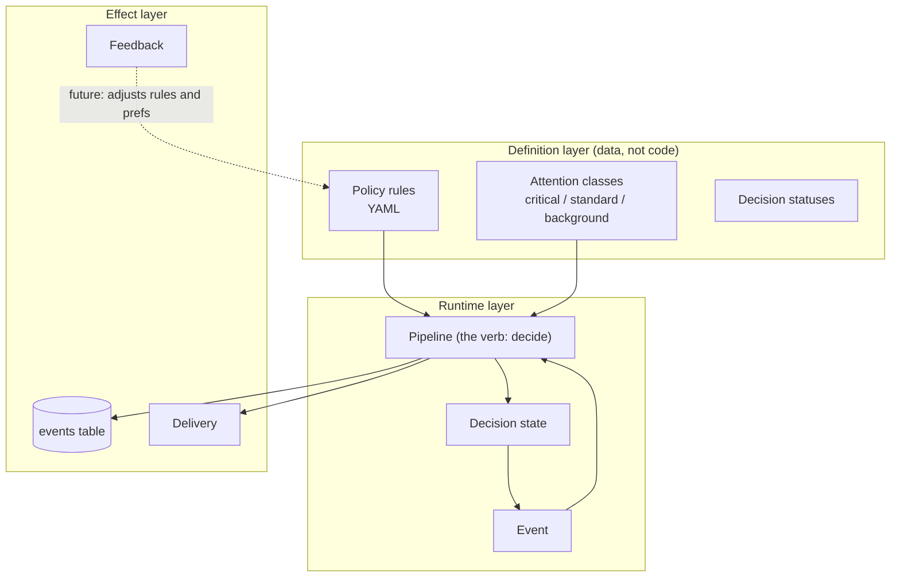

The pipeline is the only place that decides. Handlers decode and encode. Repositories store. Providers send. Layer 2, when built, becomes a second decider for events the pipeline leaves `queued`; it never sees `critical`.

---

## 7. Definition Model

"Definition" means the data that tells the system *how to decide*, as opposed to the code that executes decisions.

### How the concepts relate

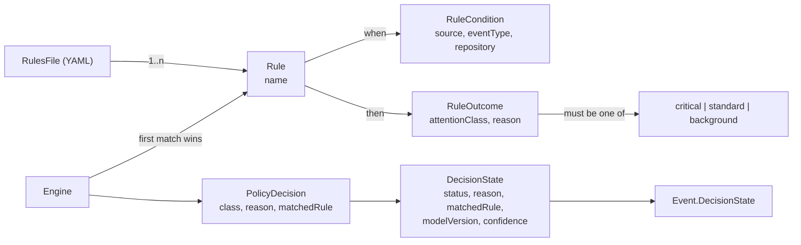

- A **rule** is `name` + `when` (any of source, event type, repository; omitted fields match anything) + `then` (attention class and a human reason).
- Rules are evaluated **in file order; the first match wins.** No match means `standard` with the reason `no matching rule, default standard`.
- `ParseRules` rejects an empty file, a missing name, a missing class and an unknown class, so a typo such as `critcal` cannot silently demote an alert.
- With no `RULES_PATH`, built-in defaults apply: GitHub security advisories are critical; all other GitHub events are standard.
- The shipped `config/rules.yaml` adds Dependabot alerts (critical) and stars (background).

### What is missing from the definition layer

| Gap | Consequence |
|---|---|
| Conditions cannot test **payload fields** (severity, branch, label, author) | A `push` to `main` and to a feature branch look identical to the engine |
| No **priority or ordering controls** beyond file order | Rule authors must manage order by hand |
| No **per-user or per-team scope** | Every recipient gets the same classification |
| No **attention budget, quiet hours or schedule** definitions | Layer 2 has nothing to enforce |
| No **channel routing definitions**: critical recipients are the static `DEFAULT_NOTIFY_EMAIL` and Slack/Teams URLs | Cannot route "security to on-call, billing to finance" |
| **No rule versioning, audit trail or hot reload**; rules load once at start | Changing a rule needs a restart and leaves no history |
| **Unknown YAML keys are ignored** (non-strict decode) | A misspelt `eventTpye` silently matches everything |
| No **dry-run or test harness** for rules | Cannot preview what a rule change would do to past events |
| **Feedback types are not defined**: any string is accepted, and the dashboard offers `opened/dismissed/replied/ignored` while the charter names `opened/dismissed/undo/always/never/replies` | Training signals will be inconsistent |
| `DecisionState.ModelVersion` and `Confidence` exist but nothing sets them | Reserved for Layer 2 |

---

## 8. System Architecture

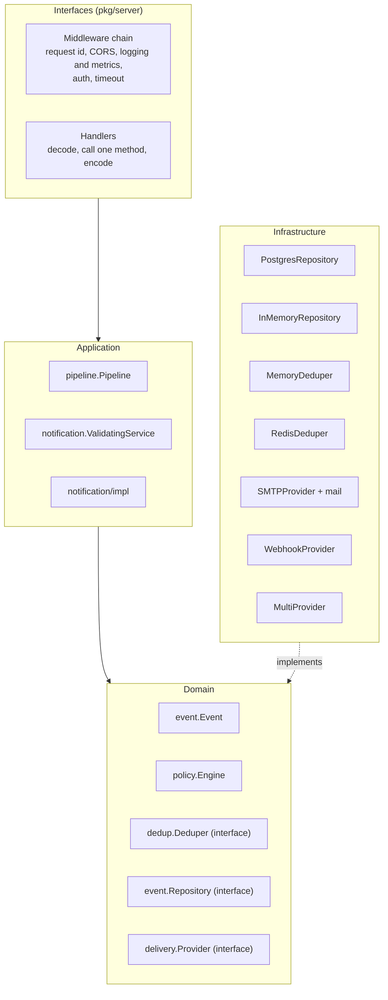

Dependencies point inward. Interfaces live next to their consumers; implementations are injected in `server.NewServer`. There is no package-level mutable state.

### 8.1 Layer responsibilities

| Layer | Package(s) | Responsibility | Must not |
|---|---|---|---|
| **Interfaces** | `server`, `util` | Routing, auth, CORS, size and time limits, status codes, JSON | Contain business rules or SQL |
| **Application** | `pipeline`, `notification`, `notification/impl` | Orchestrate a use case; validate untrusted requests | Know about HTTP or SQL |
| **Domain** | `event`, `policy`, `dedup` (interface and key logic), `delivery.Provider`, `feedback` | Entities, rules, contracts | Import infrastructure |
| **Infrastructure** | `db`, `event.PostgresRepository`, `dedup.RedisDeduper`, `delivery.SMTPProvider`, `delivery.WebhookProvider`, `mail`, `learning`, `metrics` | Talk to PostgreSQL, Redis, SMTP, HTTP, Ollama | Decide policy |
| **Composition root** | `cmd/notification-service`, `server.NewServer` | Read config, build and wire everything | Hold logic |

### 8.2 Why the orchestrator exists

The `pipeline.Pipeline` is the single place where *decide* happens, for three reasons:

1. **It enforces the invariant.** The critical branch (deliver, then record) and the "never merge critical" rule live in one function, not scattered across handlers. A new ingestion route cannot bypass it.
2. **It makes failure behaviour explicit.** The order is fixed: duplicate check, policy, dedup, deliver, save. On a failed delivery or save it releases the dedup entry so the retry is processed, not suppressed. On a dedup-store outage it fails open.
3. **It keeps layers swappable.** Policy, deduper, repository and provider are injected interfaces, so Layer 2 can be added as another stage without touching handlers, and Novu can replace SMTP without touching the pipeline.

---

## 9. Component Inventory

Fifteen library packages plus the entry point.

| Package | Role | Key types and functions | Layer |
|---|---|---|---|
| `cmd/notification-service` | Entry point | `main`: load config, build slog logger, trap SIGINT/SIGTERM, run | root |
| `config` | Environment configuration, validated at start | `Config`, `LoadConfig`, `WebhookHostAllowList` | infra |
| `server` | HTTP routing, middleware, handlers, retention loop | `Server`, `NewServer`, `Handler`, `Run`, `eventsHandler`, `authMiddleware`, `webhookAuthMiddleware`, `corsMiddleware`, `timeoutMiddleware`, `runRetention` | interface |
| `pipeline` | The orchestrator | `Pipeline.Handle`, `ErrDuplicateDelivery`, `WithDeduper`, `WithLogger` | application |
| `notification` | Request model, validation | `NotificationRequest`, `Limits`, `ValidatingService`, `ErrInvalidRequest` | application |
| `notification/impl` | Default send service | `NotificationServiceImpl.Send` | application |
| `event` | Entity and persistence | `Event` (with `CreatedAt`), `DecisionState`, `Repository`, `Purger`, `PostgresRepository`, `InMemoryRepository` | domain / infra |
| `policy` | Rule engine | `Rule`, `Engine.Evaluate`, `LoadRulesFromFile`, `ParseRules`, `DefaultRules` | domain |
| `dedup` | Dedup and threading | `Deduper`, `MemoryDeduper`, `RedisDeduper`, `KeyStore`, `DedupKey`, `ThreadID` | domain / infra |
| `delivery` | Layer 3 providers | `Provider`, `Service`, `SMTPProvider`, `WebhookProvider`, `MultiProvider`, `StubProvider` | domain / infra |
| `mail` | Cancellable SMTP client | `Send` | infra |
| `db` | Connection and schema | `Connect`, `PoolConfig`, `Migrate`, `MigrateLocked` | infra |
| `feedback` | Layer 4 capture | `Recorder`, `InMemoryRecorder`, `EventFeedback` | domain |
| `learning` | Layer 2 stub | `Service.Summarize` (Ollama) | infra |
| `metrics` | Prometheus text exposition | `Registry`, `ObserveRequest`, `WritePrometheus` | infra |
| `util` | HTTP helpers | `WriteJSON`, `ErrorResponse` | interface |

**Other deployables:** `apps/web` (the console, below), `java-server/notification-service` (parallel Java service), `deploy/`, `k8s/`, `docker-compose.yml`.

### 9.1 Web console (`apps/web`)

React 18 and TypeScript, built with Vite, one runtime dependency beyond React (a self-hosted variable font). Logic lives in `lib/` and is unit-tested; components only render.

| Module | Role |
|---|---|
| `lib/api.ts` | The only code that calls `fetch`. Maps every failure to a kind (`unauthorized`, `unconfigured`, `unreachable`, `rejected`, `server`) |
| `lib/events.ts` | Plain-language labels, thread grouping, last-hour summary, relative time |
| `lib/settings.ts` | Service address and API key in `sessionStorage`; URL validation |
| `hooks/useEvents.ts` | Loads events, refreshes every 15 s while the tab is visible, keeps the last events during an outage |
| `components/` | `Header`, `Lead`, `Ledger`, `EventSheet`, `SettingsDialog`, `Notices`, `Flag` |

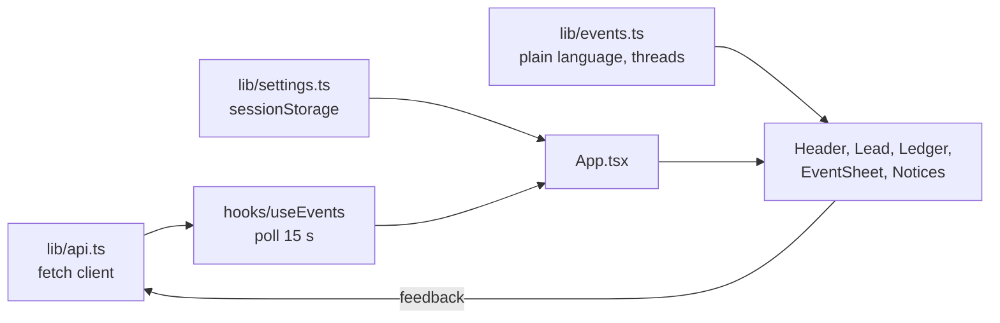

Design language, states and copy rules: [frontend.md](frontend.md).

---

## 10. End-to-End Flows

### 10.1 Webhook to decision (the main flow)

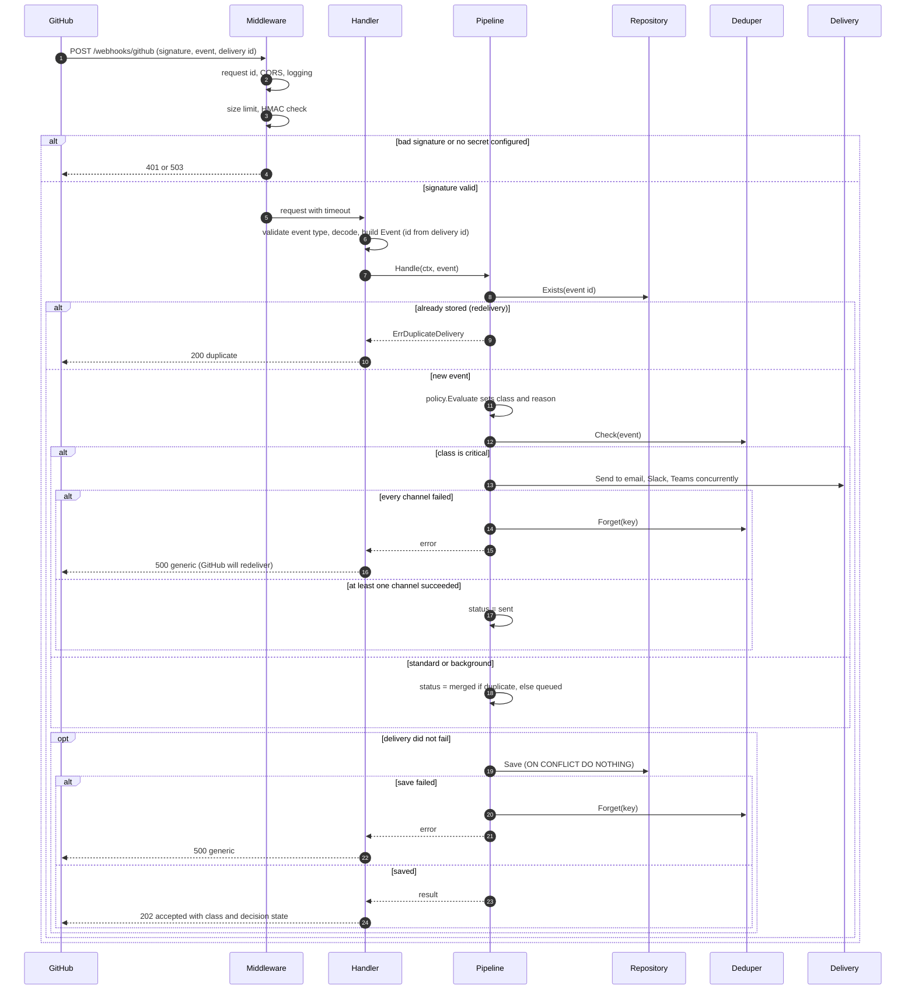

### 10.2 Agent notification (`POST /notify`)

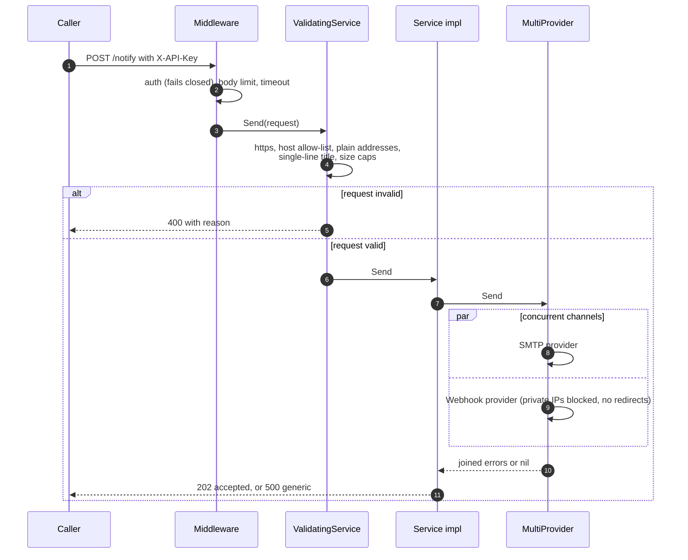

### 10.3 Deduplication across replicas

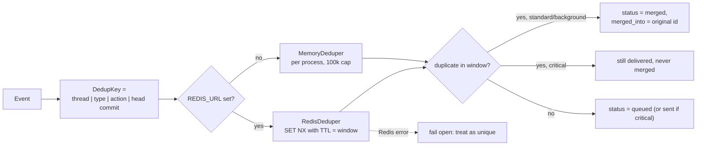

### 10.4 Retention

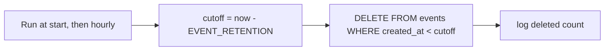

Runs only when the repository is PostgreSQL and `EVENT_RETENTION` is above zero. It stops on shutdown.

### 10.5 Start-up and shutdown

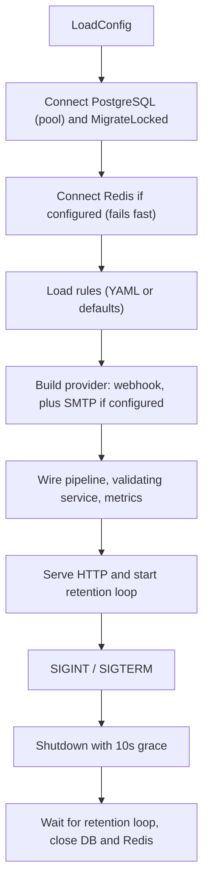

### 10.6 Console: read and give feedback

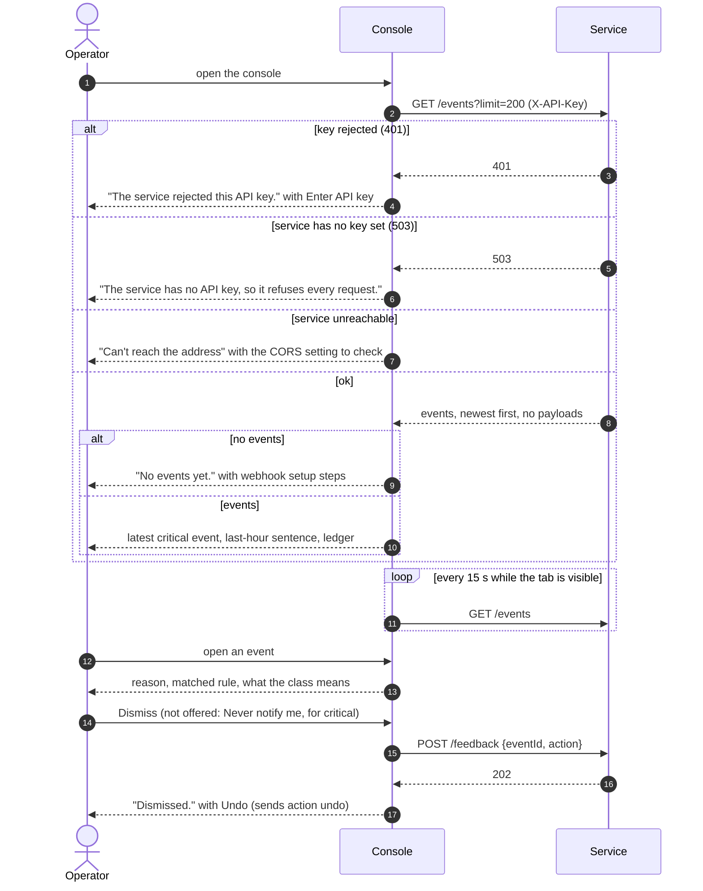

---

## 11. The Data Contracts

### 11.1 Canonical event (Go and JSON)

```go
type Event struct {
    ID             string                 // "github-<event>-<delivery id>"
    Source         string                 // "github"
    EventType      string                 // header X-GitHub-Event
    Repository     string                 // payload.repository.full_name
    AttentionClass string                 // critical | standard | background
    DecisionState  *DecisionState
    DedupKey       string
    ThreadID       string                 // "source:repo:number"
    MergedInto     string                 // original event id when merged
    Payload        map[string]interface{} // full webhook body
    CreatedAt      time.Time              // set when stored
}
```

```json
{
  "id": "github-pull_request-72d3162e-cc78-11e3-81ab-4c9367dc0958",
  "source": "github",
  "eventType": "pull_request",
  "repository": "octo/repo",
  "attentionClass": "standard",
  "decisionState": {
    "status": "queued",
    "reason": "default routing",
    "matchedRule": "default-github"
  },
  "dedupKey": "github:octo/repo:42|pull_request|opened|",
  "threadId": "github:octo/repo:42",
  "createdAt": "2026-11-04T06:32:05Z",
  "payload": { "action": "opened", "number": 42 }
}
```

### 11.2 Policy rules (YAML)

```yaml
rules:
  - name: github-security-advisory
    when: { source: github, eventType: security_advisory }
    then: { attentionClass: critical, reason: security vulnerability detected }
  - name: default-github
    when: { source: github }
    then: { attentionClass: standard, reason: default routing }
```

### 11.3 Notification request (`POST /notify`)

```json
{
  "agent": { "name": "agent1", "owner": "dev", "group": "ops" },
  "title": "Alert",
  "message": "Hello",
  "emailRecipients": ["user@example.com"],
  "slackWebhookUrls": ["https://hooks.slack.com/services/..."],
  "teamsWebhookUrls": ["https://example.webhook.office.com/..."]
}
```

Limits: title one line, at most 200 characters; message at most 20,000; 20 recipients; 10 webhook URLs; https only; hosts from the allow-list.

### 11.4 Feedback

```json
{ "id": "", "eventId": "github-star-guid-1", "userId": "u1", "action": "dismissed", "reason": "noise", "createdAt": "" }
```

`eventId` and `action` are required. Nothing else is validated (see section 3).

### 11.4a Event list (`GET /events`)

```json
{
  "events": [
    {
      "id": "github-security_advisory-sa1",
      "source": "github",
      "eventType": "security_advisory",
      "repository": "octo/payments",
      "attentionClass": "critical",
      "decisionState": { "status": "sent", "reason": "security vulnerability detected", "matchedRule": "github-security-advisory" },
      "threadId": "github:octo/payments",
      "createdAt": "2026-11-04T06:32:05Z"
    }
  ]
}
```

Newest first. `limit` is 1 to 500 (default 100). The raw `payload` is deliberately omitted because it can carry names and emails.

### 11.5 Responses

| Case | Status | Body |
|---|---|---|
| Events listed | 200 | `{events: [...]}` newest first |
| Event accepted | 202 | `{status, eventId, attentionClass, decisionState}` |
| Webhook redelivery | 200 | `{"status":"duplicate","eventId":"..."}` |
| Validation failure | 400 | `{"error":"invalid notification request: <reason>"}` |
| Missing/invalid key | 401 | `{"error":"missing or invalid api key"}` |
| Server not configured | 503 | `{"error":"api key not configured"}` or `webhook secret not configured` |
| Body too large | 413 | `{"error":"request body too large"}` |
| Internal failure | 500 | `{"error":"internal error"}` (detail is in logs, keyed by `X-Request-ID`) |

### 11.6 Metrics

`http_requests_total{route,code}`, `http_request_duration_seconds` (histogram), `notifications_accepted_total`. Route labels come from a closed set, so scanners cannot create unbounded cardinality.

### 11.7 Configuration

Security: `API_KEY`, `ALLOW_UNAUTHENTICATED_API`, `GITHUB_WEBHOOK_SECRET`, `ALLOW_UNSIGNED_WEBHOOKS`, `CORS_ALLOWED_ORIGINS`, `NOTIFY_ALLOWED_WEBHOOK_HOSTS`, `NOTIFY_ALLOWED_EMAIL_DOMAINS`, `MAX_BODY_BYTES`, `REQUEST_TIMEOUT`.
Storage: `DATABASE_URL`, `DB_MAX_OPEN_CONNS`, `DB_MAX_IDLE_CONNS`, `DB_CONN_MAX_LIFETIME`, `EVENT_RETENTION`, `REDIS_URL`, `DEDUP_WINDOW`, `RULES_PATH`.
Delivery and logs: `DEFAULT_NOTIFY_EMAIL`, `SMTP_*`, `SLACK_WEBHOOK_URL`, `TEAMS_WEBHOOK_URL`, `LOG_LEVEL`, `PORT`.
Defaults fail closed. Full table: [service README](../go-server/notification-service/README.md).

---

## 12. What Has Been Delivered

### 12.1 Milestone history

Each milestone has its own document, `docs/milestones/milestone-N.md`, with decisions, tests, acceptance and honest limits. The running index is [CHANGELOG.md](CHANGELOG.md).

| Milestone | Delivered |
|---|---|
| 1 to 4 | Repository, Docker, CI, basic API and React app, API key authentication, configuration, logging, GitHub webhook ingestion and persistence, rule engine and criticality |
| 5 to 9 | Persistence of events and decisions, the delivery abstraction (`Provider`, `Service`), SMTP, a first in-memory feedback endpoint, an Ollama stub |
| 10 to 12 | Local deployment, the end-to-end critical pipeline with YAML rules, deduplication and threading |
| 13 | Security and production hardening (see [milestones/milestone-13.md](milestones/milestone-13.md)) |
| 14 | Operator console and read API |
| 15 to 21 | Inbox with state and a detail drawer; All notifications; Overview, Activity and Analytics; editable Rules and Policies; Channels and Integrations; Preferences and live updates; Help and Support |
| 22 | Built-in delivery: a durable queue with retries and dead letters, SMS gateways |
| 23 | Accounts, sessions, roles and single sign-on |
| 24 | Stored feedback and always and never overrides |
| 25 | Attention Intelligence: heuristic classifier, digests, explanations |
| 26 | Ollama and Claude adapters behind Attention, with fallback |
| 27 | Verification: PostgreSQL contract tests and adapter replay tests |
| 28 | Learning engine: feedback becomes reviewable suggestions |
| 29 | Asynchronous attention worker and attention budgets |
| 30 | Strict rules, payload predicates, per-rule channels, per-person preferences and digests |
| 31 | AgentPulse: agent events, traces, the MCP server and the Traces screen |
| 32 | Novu provider, cursor pagination, request tracing, strict STARTTLS |
| 33 | This reconciliation of the documentation, and the Python SDK |

### 12.2 Quality gates

What was **verified locally** (Windows, after each milestone) and what was **confirmed in CI** are different, and this table keeps them apart.

| Gate | Local | CI |
|---|---|---|
| `gofmt`, `go vet`, `go vet -tags integration` | Pass | Format and vet steps passed |
| `go test -cover ./...` | Pass | |
| `golangci-lint` v2.15 | Not available locally | Found about 25 issues over four rounds, all fixed; **lint and the vulnerability scan pass** |
| `-race`, PostgreSQL and Redis integration tests, 80 percent coverage gate | Not runnable locally (no C compiler, no Docker) | **Pass** (run 42356002884, commit 367d735, PostgreSQL 16 and Redis 7). The first real run had failed on two bugs the in-memory tests could not see (overrides could not be saved in PostgreSQL; an integration test used `TRUNCATE` across a foreign key); both were fixed |
| Web: `npm test`, `npm run build` | 230 tests pass, build succeeds | The web job passes |
| Java service | Rewritten in milestone 34 (core) | Passes locally and on GitHub (run 42368107261 on commit b562715) |

Local statement coverage by package is in [implementation-sync.md](implementation-sync.md); several packages are below the 80 percent target when integration tests do not run.

### 12.3 Verdict

**Sound and broad, with its least-proven parts clearly marked.** The deterministic core, the delivery path, the intelligence layer and the console are built and tested. The first CI run on this branch found real defects in code that had only been run in memory, which is exactly why the integration tests exist. The Go, web and Python SDK CI jobs pass on commit 367d735; the Java job fails and is unrelated. What is still unproven is anything that needs a real third-party service (Ollama, Claude, Novu, SNS, an OpenID provider, a real MCP client).

### 12.4 Known limits and deferred items

| Item | Detail |
|---|---|
| Real services | PostgreSQL stores, Redis budget, Ollama, Claude, Novu, SNS, OpenID Connect and MCP clients were not exercised end to end by the author |
| Per-person delivery | Personal digests are stored, not delivered; delivery targets are workspace-wide |
| Learning | Suggests; never applies on its own; reads the newest 1000 events |
| Tracing | `traceparent` and span logs only; no collector export |
| Event window | Digests, traces and learning read the newest 1000 events |
| Console | Newer screens English only; no screens yet for rule predicates, per-rule channels or personal preferences |
| Java service | Core, `/notify`, rules API, durable queue and Redis dedup built (milestones 34 and 35, 132 tests, nine-file shared contract); **the rest to be brought to parity** (planned) |
| NATS | In the intended stack only; not in Compose and not used |
| At-least-once critical delivery | If an alert is delivered but saving fails, the redelivery notifies again. Deliberate: a duplicate beats a lost critical alert |

---

## 13. Forward Roadmap

| Step | Goal |
|---|---|
| **Verify against real services** | Run PostgreSQL, Redis, Ollama, Claude, Novu, SNS, an OpenID provider and a real MCP client against the code; record results; fix what they find. Get the CI run green end to end, including `-race` and the coverage gate |
| **SDKs for other languages** | Documented only (2026-11-07): TypeScript/JavaScript, Go and Java first, modelled on the Python SDK (never breaks the agent, never decides severity, tested against a fake server and the real binary). No language order or build approach chosen; see `upcoming-milestones.md` |
| **Per-person delivery** | Resolve a person's address at send time without storing it in jobs; deliver personal digests; per-person schedules and budgets |
| **Console completeness** | Screens for predicates, per-rule channels, personal preferences and "my digest"; translations for the newer screens; component-level tests |
| **Queue and scale** | Move the worker and delivery from polling to NATS (or another queue) if polling stops being enough; share the circuit breaker across replicas |
| **Observability** | An OpenTelemetry exporter for the spans already recorded |
| **Product** | Event replay, an agent registry, multi-tenancy and billing for the hosted offering |
| **Java parity** | Milestones 34 and 35 built the core, `/notify`, the rules API, the durable queue and Redis dedup, and the shared contract suite (`docs/contract`, replayed by both services). Next: bring the remaining Go features to Java in an order the project owner chooses, extending the contract each time |
| **Housekeeping** | Reconcile the two `k8s/` directories; raise packages below 80 percent coverage |

---

## 14. Architecture Delta Summary

What the plan and vision say versus what is built.

| Area | Planned or promised | Built | Delta |
|---|---|---|---|
| Layer 1 policy and dedup | Rules, criticality, dedup, threading, payload predicates, scoped routing | All, including strict YAML, payload predicates, per-rule channels and agent-run threads | None known |
| Layer 2 AI | Classify, group, digest, schedule, learn, explain | Heuristic plus optional Ollama and Claude; digests; explanations; budget and worker; suggestions from feedback | Models not exercised against the real services; learning is advisory |
| Layer 3 delivery | Novu via abstraction; email, Slack, SMS | SMTP, Novu, Slack, Teams, SMS, durable queue | Novu not run against the real service |
| Layer 4 feedback | Opened, dismissed, undo, always, never, replies; training signals | Stored, attributed, overrides, learning suggestions | None known |
| Data | PostgreSQL events, decisions, feedback, preferences | 15 tables covering events, inbox state, trail, preferences, personal preferences, rules, delivery jobs, users, identities, sessions, feedback, overrides, digests, suggestions, audit | PostgreSQL paths proven only in CI |
| Cache | Redis for dedup keys and budget counters | Redis dedup and budget | Budget script proven only in CI |
| Messaging | NATS event bus | Not used | Deferred; PostgreSQL queue instead |
| Security | Auth, hardening | API key, accounts, sessions, CSRF, roles, OIDC, audit, HMAC, SSRF controls, strict STARTTLS option | OIDC not run against a real provider |
| Observability | Logging, tracing | Logs, request IDs, Prometheus, `traceparent` and span logs | No collector export |
| Integration | MCP server, SDK, agent registry, replay | MCP server (stdio and HTTP), Python SDK, agent events and traces | Agent registry and replay not built; MCP not tried with a real client |
| UI | Dashboard, digest UI, traces | 15 screens, demo mode, themes, languages | Newer screens English only |
| Docs | Accurate status | Reconciled in milestone 33 | Keep `implementation-sync.md` current |


---

## 15. 🗃️ ER Diagram (Entity Relationship)

The only table that exists is `events`. Feedback currently lives in memory. The planned tables are shown dashed in the second diagram.

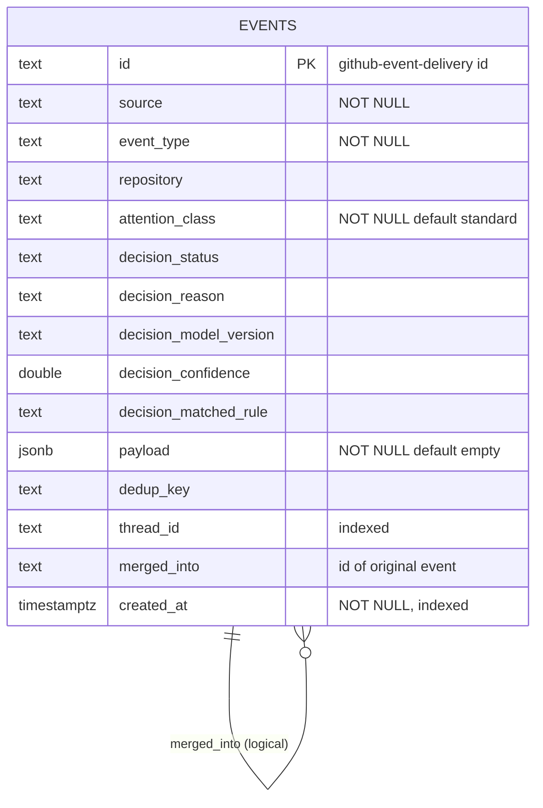

Indexes: primary key on `id`, `events_thread_id_idx`, `events_created_at_idx` (retention and recency queries). Migrations are idempotent and run in one transaction under an advisory lock at start. `merged_into` is a logical reference, not a foreign key, so retention can delete an original without cascading.

**Planned schema (not built):**

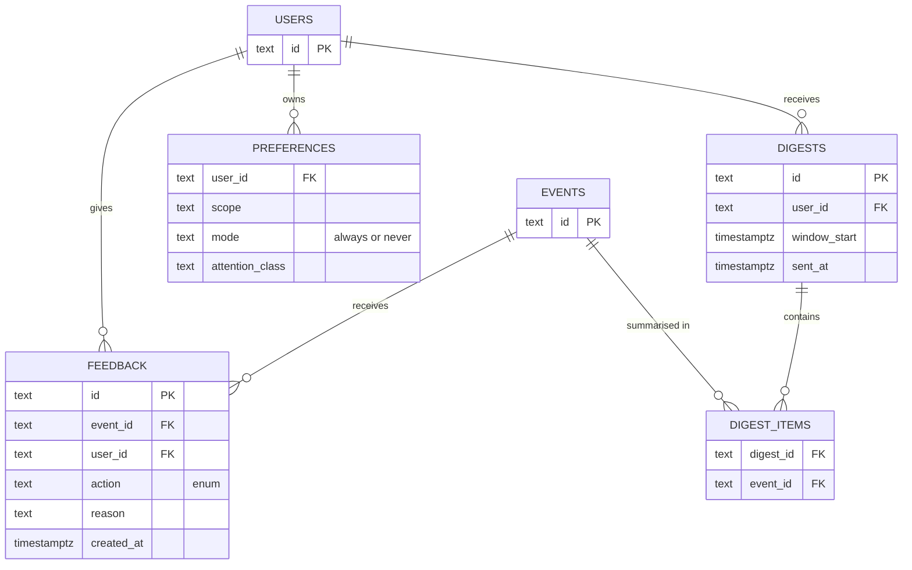

---

## 16. 📐 UML: Key Class Relationships

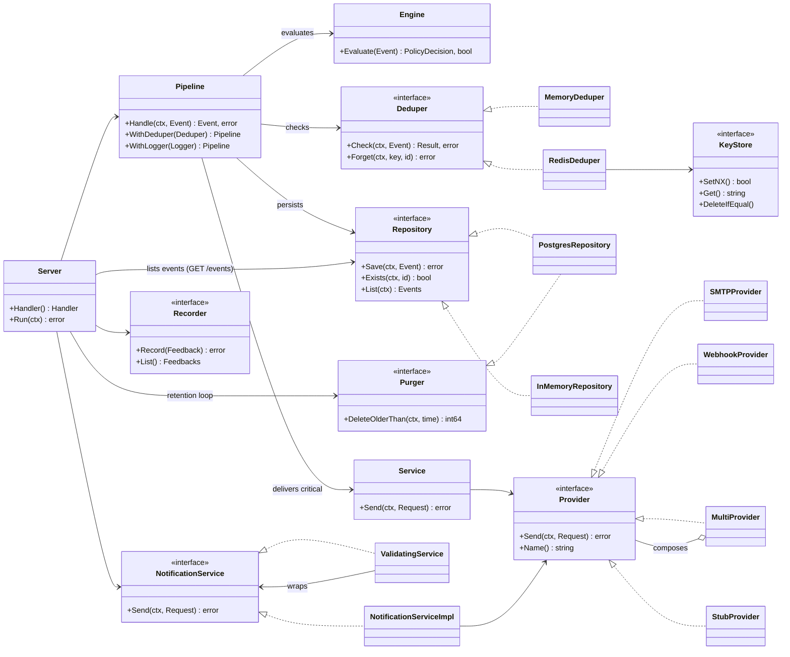

---

## 17. 🔄 Pipeline Lifecycle: State Machine

An event's life through the pipeline. Only `sent`, `queued` and `merged` are stored as `decision_status` today; the other states are transient or planned.

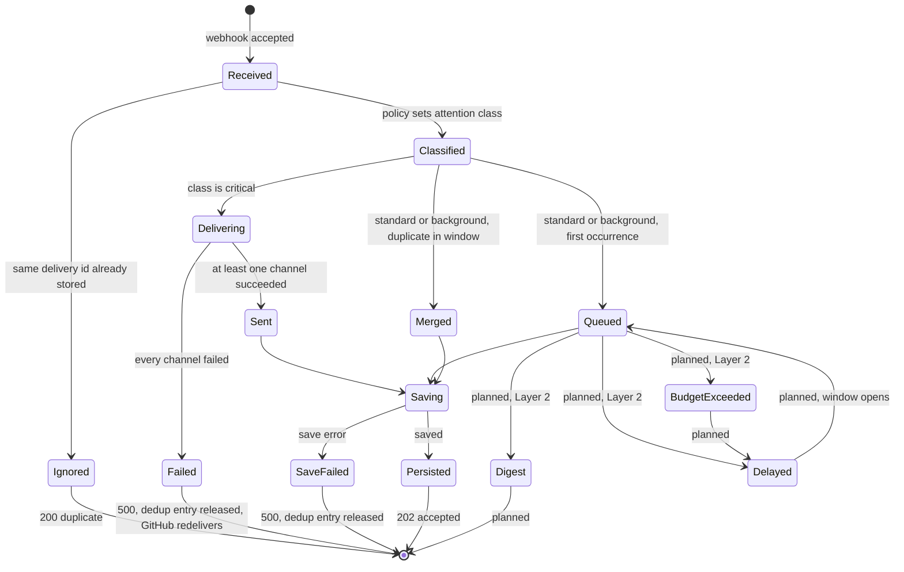

`Digest`, `Delayed` and `BudgetExceeded` are planned and unreachable today. `Queued` events currently stay queued forever.

| Status | Set by | Meaning |
|---|---|---|
| `sent` | pipeline, critical branch | Delivered through the configured channels |
| `queued` | pipeline, standard/background | Stored, waiting for Layer 2 (**nothing consumes it yet**) |
| `merged` | pipeline, duplicate | Folded into `merged_into`; not delivered separately |
| `digest`, `delayed`, `budget_exceeded` | **nobody yet** | Reserved for Layer 2 |

Invariants enforced by tests: critical events are never `merged`; a failed delivery or save never leaves a dedup entry that would suppress the retry; a redelivered ID never notifies twice.

---

## 18. 🧰 Design Patterns Used

| Pattern | Where | Why |
|---|---|---|
| **Clean / layered architecture** | Whole service | Dependencies point inward; domain has no I/O imports |
| **Repository** | `event.Repository`, `PostgresRepository`, `InMemoryRepository` | Swap storage; tests use the in-memory fake |
| **Strategy** | `delivery.Provider` (SMTP, Webhook, Stub; Novu later) | Choose delivery by configuration |
| **Composite** | `MultiProvider` | Treat many providers as one; concurrent fan-out with joined errors |
| **Decorator** | `ValidatingService`, middleware chain | Add validation, auth, logging without changing the wrapped code |
| **Adapter** | `dedup.redisStore` over go-redis | Keep the Redis client out of domain logic and out of tests |
| **Null object** | `StubProvider`, in-memory deduper and repository | Run and test without infrastructure |
| **Dependency injection** | `server.NewServer` | One composition root; no globals |
| **Pipeline / chain of responsibility** | `pipeline.Handle` | Ordered stages with one invariant |
| **Idempotent consumer** | Delivery-ID event IDs, `Exists`, `ON CONFLICT DO NOTHING` | Safe under at-least-once webhooks |
| **Fail closed / fail open (by risk)** | Auth, webhook secret, rules: closed. Dedup store: open | Security gates deny on doubt; availability features never suppress an alert |
| **Compensating action** | `Deduper.Forget` after a failed save or delivery | Undo a side effect so a retry is processed |
| **Bounded resources** | Body limit, request timeout, pool size, dedup cap, feedback cap, list cap | Prevent unbounded memory, latency and load |
| **Functional options (builder-style)** | `WithDeduper`, `WithLogger` | Optional collaborators without constructor sprawl |
| **Advisory lock** | `MigrateLocked` | One replica migrates at a time |
| **Closed label set** | `routeLabel` | Bounded metric cardinality |

---

## 19. 🔌 Key API Endpoints

Auth: **key** means the API key or a signed-in session; **admin** means an admin session or the API key; the webhook uses an HMAC. The details of each route are in its milestone document.

| Method and path | Auth | Purpose |
|---|---|---|
| `GET /health` | none | Liveness and readiness |
| `GET /metrics` | key | Prometheus metrics |
| `POST /webhooks/github` | HMAC `X-Hub-Signature-256` | Ingest a GitHub event; 202 with the decision, 200 `duplicate` on redelivery |
| `POST /api/events` | key | Ingest one agent step (trace, parent, agent, metadata); same pipeline as a webhook |
| `GET /events`, `GET /api/events` | key | Recent events, newest first; `?limit=`, `?cursor=`, `?traceId=` (`/api/events`) |
| `POST /notify` | key | Send a validated notification |
| `POST /feedback` | key | Record opened, dismissed, undo, always, never or reply |
| `GET /api/notifications` and `/api/notifications/{id}` and actions | key | The inbox: filters, sort, `?cursor=` or `page`, state changes, bulk actions |
| `GET /api/analytics`, `GET /api/activity` | key | Overview, analytics and activity data |
| `/api/rules` (list, create, update, delete, `reorder`, `test`), `GET /api/policies` | key to read, admin to change | Rules, with payload predicates and per-rule channels; dry runs accept a sample payload |
| `GET /api/channels`, `POST /api/channels/{id}/test`, `GET /api/integrations` | key, admin to test | Channel and integration status; rate-limited test sends |
| `GET /api/deliveries`, `POST /api/deliveries/{id}/retry` | key, admin to retry | The delivery queue and dead letters |
| `GET`/`PUT /api/preferences` | key to read, admin to change | Workspace quiet hours and mutes |
| `GET`/`PUT /api/me/preferences` | signed-in person | Personal preferences with workspace fallback |
| `GET`/`POST`/`DELETE /api/overrides` | key | Always and never notify choices |
| `GET /api/digests`, `GET /api/digests/{id}`, `POST /api/digests/generate` | key; admin to generate | Workspace digests; `?scope=me` for the signed-in person's own (any person may make theirs) |
| `GET /api/explain/{eventId}` | key | Plain-language reason for a decision, labelled heuristic or model |
| `GET /api/attention/status` | admin | Which engine is active, breaker state, fallbacks |
| `GET /api/learning/suggestions`, `POST .../{id}/apply`, `POST .../{id}/dismiss` | key to read, admin to resolve | Suggestions from feedback |
| `GET /api/traces`, `GET /api/traces/{id}` | key | Agent runs and their ordered steps with decisions |
| `POST /api/mcp` | key | Model Context Protocol over HTTP (one JSON-RPC message per request) |
| `GET /api/stream` | key | Server-sent events for live updates |
| `/api/auth/*`, `/api/users`, `GET /api/audit` | public sign-in routes; admin for users and audit | Accounts, sessions, single sign-on, audit trail |

Every response carries `X-Request-ID` and `traceparent`.

**Middleware order**, outermost first: request ID, tracing, CORS, logging and metrics, auth (protected routes) or signature (webhook), request timeout, handler. Logging wraps auth so rejected requests are counted; unknown paths share one metric label so a scan cannot create unbounded series.

---

## 20. Cross-Cutting Concerns

### 20.1 Security

| Control | Mechanism |
|---|---|
| Authentication | `X-API-Key`, constant-time compare, fails closed when unset |
| Webhook integrity | HMAC-SHA256 over the raw body, constant time, fails closed |
| Replay | Delivery ID is part of the event ID; redeliveries are no-ops |
| SSRF | https only, host allow-list, private/loopback/link-local blocked at dial time, redirects not followed |
| Injection | Parameterised SQL only; mail headers flattened; recipients parsed |
| Browser | CORS closed unless origins are listed |
| Resource abuse | Body limit on every route, server and per-request timeouts, pool limits |
| Secrets | Environment or Kubernetes Secret; never logged; `secret.example.yaml` shows the keys |
| Supply chain | `govulncheck` in CI; pinned toolchain; pinned linter |
| Data | Retention deletes events after 90 days by default. Payloads can contain names and emails, so keep TLS on the database link |

### 20.2 Performance and scalability

- Stateless service; scale by replicas. Set `REDIS_URL` first, or each replica dedups alone.
- Hot path: one `Exists` read, one dedup check, one insert, and for critical events concurrent sends bounded by `REQUEST_TIMEOUT`.
- Known ceiling: critical delivery runs inside the webhook request. A slow provider holds the request until the timeout (25 s by default, but GitHub gives up at 10 s and redelivers, which the idempotency check absorbs). Moving delivery to an async worker is the first scaling change.
- `List` is capped at 1,000 rows; there is no pagination API yet.

### 20.3 Reliability and failure modes

| Failure | Behaviour |
|---|---|
| One delivery channel down | Other channels still sent; errors joined and logged |
| All channels down (critical) | 500, dedup entry released, GitHub redelivers |
| Database down | 500 generic; retry processed later |
| Redis down at runtime | Fail open: events treated as unique |
| Redis unreachable at start | Start-up fails fast |
| Duplicate webhook | 200 `duplicate`, no side effects |
| Process stops | Graceful drain up to 10 s, then close DB and Redis |

### 20.4 Observability

JSON logs with `request_id`, `event_id`, `thread_id`, `attention_class`, `decision_status`, `http_status`; Prometheus counters and latency histograms (P99 via `histogram_quantile`); alert on burn rate, not raw thresholds. Runbook: [runbook.md](runbook.md). Tracing is deferred.

### 20.5 Testing strategy

Unit tests use in-memory fakes behind the same interfaces as production. Real-infrastructure tests (`-tags integration`) run against PostgreSQL. Invariant tests cover "critical is never merged", "redelivery never notifies twice" and "a failed save does not suppress the retry". CI runs the race detector and an 80% coverage gate.

---

## 21. Guidance Per Role

| Role | Start here | Rules of thumb |
|---|---|---|
| **New backend engineer** | Sections 8, 9, 10.1; the service README | Handlers stay thin. New I/O gets an interface, a fake, a context and a timeout. Add a test for the failure path, not just success |
| **Operator / SRE** | [runbook.md](runbook.md), sections 19 and 20 | Probe `/health` (no key). Set `API_KEY`, `GITHUB_WEBHOOK_SECRET`, `REDIS_URL` before scaling. Alert on 5xx ratio and P99 of `/webhooks/github` |
| **Security reviewer** | Sections 10, 11.5, 20.1 | Check fail-closed defaults, allow-lists, constant-time compares. Open items: user auth, STARTTLS, dashboard key |
| **AI / ML engineer (Layer 2)** | Sections 3, 7, 13 (B and C), 17 | You only ever receive `standard` and `background`. Set `modelVersion` and `confidence`. Never call a model from Layer 1, and never alter a `critical` decision |
| **Frontend engineer** | [frontend.md](frontend.md), sections 9.1, 10.6, 11.4a, 19 | Logic goes in `lib/` with tests; components only render. Keep meaning in shape and width as well as colour; copy is plain, sentence case, and errors say what to do. Never ship an API key in a bundle |
| **Product owner** | Sections 3, 5, 12.3, 14 | The product promise lives in Layer 2, which is not built. Standard events are recorded, not yet orchestrated |
| **Integrator (agents, n8n)** | Sections 11.3, 19 | Send over `/notify` with an API key; webhook and email targets must be on the allow-list; expect 400 with a reason |

---

## 22. Status-at-a-Glance

"Done" means built and tested locally. "Proven" additionally means it has run against the real service or in CI; the column says which.

| Area | Status | Proven |
|---|---|---|
| Layer 1: ingestion, rules (payload predicates, channels, strict YAML), dedup, threading | **Done** | Locally; PostgreSQL and Redis paths in CI |
| Critical path (never suppress, never deferred, never budgeted, never changed) | **Done** | Invariant tests in every milestone from 25 |
| Layer 2: heuristic classifier, digests, explanations | **Done** | Locally |
| Layer 2: Ollama and Claude adapters | **Done** | Against local fakes only |
| Layer 2: learning suggestions | **Done** | Locally; repository in CI |
| Attention budget, async worker, quiet-hours release | **Done** | Locally; PostgreSQL queue and Redis script in CI |
| Layer 3: email (SMTP, Novu), Slack, Teams, SMS, retry queue | **Done** | Locally; Novu and SNS against fakes only |
| Layer 4: feedback, overrides, audit | **Done** | Locally; PostgreSQL stores in CI |
| Accounts, sessions, roles, OpenID Connect | **Done** | OIDC against a fake provider only |
| Agent events, traces, MCP server, Python SDK | **Done** | MCP and SDK against local servers; no real MCP client |
| PostgreSQL persistence and retention | **Done** | CI |
| Redis dedup and budget across replicas | **Done** | CI |
| Security hardening | **Done** | Lint and vulnerability scan passed in CI |
| Metrics, logs, request IDs, `traceparent` and span logs | **Done** | Locally; no collector export |
| Console: 15 screens, demo mode, themes, languages | **Done** | 230 Vitest tests, production build; newer screens English only |
| Docker, compose, Kubernetes, CI | **Done** | The Go and web CI jobs pass the steps that have run; see section 12.2 |
| Per-person delivery | Not built | Personal digests are stored, not delivered |
| NATS | Not used | Named in the intended stack only |
| Java service | Core parity built; the rest planned | `java-service` job green on GitHub (run 42368107261 on commit b562715) |
| Event replay, agent registry | Not planned | Vision documents only |

**One-line summary:** the four layers are built end to end and the critical invariant is tested at every layer; the remaining work is proving the parts that have only run against fakes, per-person delivery, and the console screens that are still API-only.

---

## 23. Change Record

Everything changed on `feature-impl` since the milestone 13 plan, in the order it happened. The running index is [CHANGELOG.md](CHANGELOG.md); per-milestone detail is in [milestones/milestone-13.md](milestones/milestone-13.md) and [milestones/milestone-14.md](milestones/milestone-14.md).

| # | Change | Where | Why |
|---|---|---|---|
| 1 | Added the `golang-pro` and `tarun-code-review` skills | [`skills/`](../skills/README.md) | Reference guides for Go work and PR review |
| 2 | Principal-engineer review of the Go service (verdict BLOCK), then fixed | [milestones/milestone-13.md](milestones/milestone-13.md) step 6 | Close the security, reliability and scale findings |
| 3 | API and webhook security: fail-closed auth with constant-time compare, SSRF and recipient validation, header-injection defence, body limits, server timeouts, CORS allow-list | `server`, `notification`, `delivery`, `config` | An open `/notify` could be used to reach internal hosts |
| 4 | Reliability: concurrent channels with joined errors, webhook idempotency via the delivery ID, dedup `Forget` after failure, push commits in the dedup key, collision-free event IDs | `delivery`, `pipeline`, `dedup`, `server` | Critical alerts must not be lost or duplicated, and retries must not be suppressed |
| 5 | Scale and data: Redis dedup, pool settings, migration advisory lock, retention, capped list, `created_at` index, capped feedback recorder | `dedup`, `db`, `event`, `feedback`, `server` | Run more than one replica and bound growth |
| 6 | Observability: Prometheus metrics with latency histograms, `http_status` log field, real status codes in logs and metrics | `metrics`, `server` | Alert on burn rate and P99; fix a bug that logged 200 for everything |
| 7 | Bugs found and fixed: status always 200, NULL `repository` on list, unknown attention class accepted, unbuildable Go Dockerfile, Go standard library vulnerabilities | `server`, `event`, `policy`, `Dockerfile`, `go.mod` | Found by the integration test, the smoke test and the vulnerability scan |
| 8 | Deployment: multi-stage non-root Docker image, Kubernetes secrets and probes, compose Redis and CORS, toolchain Go 1.26.10 | `Dockerfile`, `k8s/`, `docker-compose.yml`, `go.mod` | No secrets in manifests; clean vulnerability scan |
| 9 | CI: gofmt, vet with integration tag, `golangci-lint` v2.15, `govulncheck`, race tests against PostgreSQL, 80% coverage gate, `mvn verify`, web tests | `.github/workflows/ci.yml`, `.golangci.yml` | Enforce the standards instead of documenting them |
| 10 | Tests: PostgreSQL integration tests, delivery, dedup, pipeline, server, config, policy and learning coverage | `*_test.go` | Real-infrastructure and invariant tests |
| 11 | Docs: runbook, a README in every package, this architecture document | `docs/`, `pkg/*/README.md` | Operability and a single reference |
| 12 | **Read API** `GET /events` and `Event.CreatedAt` | `server/handlers.go`, `event` | The console needs to read decisions |
| 13 | **Attention console**: new frontend with its own design language (signal flags, width-encoded type), typed API client, plain-language helpers, error and empty states, settings in `sessionStorage` | `apps/web`, [frontend.md](frontend.md) | Replace the placeholder dashboard |
| 14 | Frontend tooling: Vitest and 34 tests, `npm test` in CI, favicon, generated `tsbuildinfo` and `vite.config.js` untracked and ignored, compose CORS now includes `http://localhost:3000` | `apps/web`, `.gitignore`, `docker-compose.yml`, CI | Test the logic; stop tracking build output |
| 15 | Documentation of all of the above | `docs/milestones/milestone-14.md`, `docs/frontend.md`, `apps/web/README.md`, service README, runbook, CHANGELOG, this document | Every change recorded |

**Breaking changes to know about:** protected routes return 503 until `API_KEY` is set; `/metrics` is Prometheus text; the log field `status` is now `http_status`; webhook event IDs embed the delivery ID; `dedup.Deduper`, `event.Repository` and `db.Connect` changed signature. Full list: [CHANGELOG.md](CHANGELOG.md).

### 23a. Milestones 15 to 21 (console and operations)

| Milestone | Backend | Console |
|---|---|---|
| 15 | `pkg/inbox`, `/api/notifications` (state, trail, bulk), tables `notification_state`, `event_trail` | Routed shell, Inbox v2, detail drawer |
| 16 | none (existing filters reused) | All Notifications table, CSV export |
| 17 | `pkg/insights`, `/api/analytics`, `/api/activity`, `inbox.Repository.RecentTrail` | Overview, Activity, Analytics |
| 18 | `pkg/rules`, `/api/rules` (CRUD, reorder, dry run), `/api/policies`, table `policy_rules`, run-time `policy.Engine.SetRules`, locked rules | Rules, Policies |
| 19 | `pkg/channels`, `pkg/integrations`, `/api/channels`, `/api/channels/{id}/test`, `/api/integrations` | Channels, Integrations |
| 20 | `pkg/preferences`, `pkg/stream`, `/api/preferences`, `/api/stream` (SSE), table `preferences`, pipeline hooks | Preferences, live indicator |
| 21 | none | Help and Support, diagnostics |

Layer rules held throughout: Layer 1 stays deterministic (rules, preferences and dedup contain no AI), and critical events are never merged, delayed, muted or lowered. That is enforced in `pkg/rules` (locked rules), `pkg/preferences` (`Decide`) and `pkg/inbox` (priority guard), each with tests. Details: [milestones/milestone-16.md](milestones/milestone-16.md) to [milestones/milestone-21.md](milestones/milestone-21.md).

**Still open:** user authentication, pagination and search, persisted and validated feedback, the AI attention worker, digests, Novu, tracing, STARTTLS requirement, and the Java service review (section 13).

### 23b. Milestones 22 to 33

Milestones 22 to 33 are recorded in [CHANGELOG.md](CHANGELOG.md) and in `docs/milestones/milestone-22.md` to `docs/milestones/milestone-33.md`, and summarised in section 12.1. The shared handshake between design and implementation, including decisions, verification gaps and open questions, is [implementation-sync.md](implementation-sync.md).
