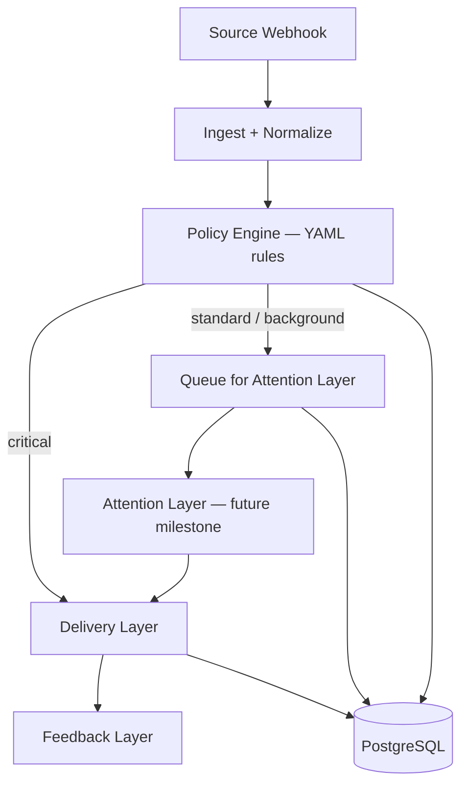

# Attention Orchestration Platform Architecture

> **Status after Milestone 33.** This document is the design narrative. [architecture.md](architecture.md) is the checked reference for what is built, and [implementation-sync.md](implementation-sync.md) records what has and has not been proven.

Modern notification systems must *respect user attention* rather than simply broadcasting alerts. Early work by Horvitz et al. described a "notification platform" that sits as an **attention-savvy layer** between incoming messages and the user, weighing the value of information against the cost of interruption. In our design, we take this further: instead of a pure "notification delivery platform," we build an **Attention Orchestration Platform** that uses AI only in the middle layer.

## Pipeline Overview

```
Sources (GitHub, Jira, Webhooks…)
   → 1. Event Layer        (deterministic: ingest, normalize, validate, dedupe)
   → 2. Attention Layer   (AI: classify, group, schedule, digest — Standard/Background only)
   → 3. Delivery Layer    (deterministic: format and route to channels)
   → 4. Feedback Layer    (capture reactions, preferences, undo)
   → Future Learning
```

**Critical events bypass Layer 2 entirely.** The pipeline evaluates policy rules in Layer 1 and routes critical events straight to delivery.



Each layer has distinct responsibilities, minimizing where AI is needed and keeping the rest deterministic:

- **Event Layer:** Ingests and normalizes events from all sources (e.g. GitHub PRs, Jira issues, custom webhooks). Applies *deterministic logic*: validate fields, deduplicate repeated events, and run data-driven rules to assign an *attention class*. An **event bus / publish-subscribe** pattern (NATS, future milestone) decouples sources from processors. If an event is classified as **Critical**, it bypasses the Attention Layer and proceeds immediately to delivery.

- **Attention Layer (LLM Classification):** The AI-controlled heart of the system. Classifies and groups non-critical events, schedules them, assigns priorities, and generates summary digests. Only "standard" and "background" events enter this layer. Critical events never touch AI.

- **Delivery Layer:** Multi-channel notification hub (email, Slack, SMS) through a provider abstraction. No AI — merely formats and routes messages. Integrates with Novu (or similar) through a `NotificationProvider` interface. Observes success/failure and respects user channel preferences.

- **Feedback Layer:** Logs user responses (opened, dismissed, snoozed, replies) and provides one-click feedback in digests. Interactive controls: *Always Notify*, *Never Notify*, *Undo*. Captured reactions feed future learning.

## Canonical Event Schema

Every event carries first-class attention metadata. JSON API responses use camelCase; PostgreSQL columns use snake_case.

### Go domain model

```go
type Event struct {
    ID             string
    Source         string                 // e.g. "github"
    EventType      string                 // e.g. "pull_request"
    Repository     string                 // e.g. "octo/repo"
    AttentionClass string                 // "critical" | "standard" | "background"
    DecisionState  *DecisionState
    Payload        map[string]interface{} // raw source payload
}

type DecisionState struct {
    Status       string  // "sent" | "queued" | "merged" | "digest" | "delayed" | "budget_exceeded"
    Reason       string  // deterministic reason, never LLM-generated
    ModelVersion string  // set only when Attention Layer makes the decision
    Confidence   float64 // 0.0–1.0, set only for AI decisions
    MatchedRule  string  // name of the policy rule that matched
}
```

### JSON representation

```json
{
  "id": "github-pull_request-1234567890",
  "source": "github",
  "eventType": "pull_request",
  "repository": "octo/repo",
  "attentionClass": "standard",
  "decisionState": {
    "status": "queued",
    "reason": "default routing",
    "matchedRule": "default-github"
  },
  "payload": { }
}
```

### Decision status lifecycle

| Status | Set by | Meaning |
|---|---|---|
| `sent` | Pipeline (critical) | Delivered immediately to every configured channel |
| `queued` | Pipeline or the attention worker | Will be (or has been) delivered through the retry queue to the channels it is routed to |
| `merged` | Deduplication | Combined with a recent, equivalent event; never applied to critical events |
| `digest` | Rules, preferences, an override or the attention classifier | Held for the next digest |
| `delayed` | Preferences (quiet hours) | Held until quiet hours end, then released by the worker |
| `budget_exceeded` | Attention budget | Standard event held for the next digest because the rolling budget is spent; never dropped |

Critically, **all decision details are logged at write time** (not recomputed). This ensures we can always trace "why was this notification hidden six months ago?" without re-running the model.

## Notification Classes: Critical, Standard, Background

Three priority tiers with fixed policies:

- **CRITICAL**: Delivered immediately. Bypasses quiet modes, focus filters, and AI. Never delayed, merged, or budget-limited. *(P1 incident, security breach, payment failure.)*

- **STANDARD**: Normal priority. The Attention Layer may group, delay, or summarize. Consumes attention budget when delivered. *(PR review request, new assignment, team comment.)*

- **BACKGROUND**: Low priority. No real-time alerts; shown in digests or dropped when busy. Does not consume attention budget. *(Repo stars, minor comments.)*

This mirrors iOS interruption levels: Critical alerts bypass everything; Active maps to Standard; Passive maps to Background.

## Attention Budget vs Suppression

We avoid "suppression" — users don't like feeling ignored. Instead there is a finite **attention budget**: by default 10 standard interruptions per rolling hour for the workspace (`ATTENTION_BUDGET_PER_HOUR`, `0` turns it off; Redis shares it between replicas). Per-person budgets are not built yet.

- **Critical** → costs zero budget, is never throttled, always delivered.
- **Standard** → consumes one slot when it would really be delivered. An "always notify" choice skips the budget.
- **Background** → costs zero (lives in the digest).

When the budget is spent, standard events receive `decision_state.status = budget_exceeded`, are explained as such, and are included in the next digest. They are stored and visible, never dropped. Only critical items break through.

## The Central Role of Digests

Digests are the explainability interface. Instead of "AI decided something," users see:

> **Today's Digest:**
> ✓ *Merged* 8 Jira comments (you usually ignore these).
> ✓ *Delayed* 3 GitHub PR reviews (outside work hours).
> ✓ *Sent Immediately* – P1 incident, Security alert.
> ✓ *Held* – 12 repo stars (background, digest only).
> *[Undo] [Always Notify] [Never Notify]* on each item.

Machine logic determines the decision; the LLM only rephrases it into plain English:

> Machine Logic (exact condition met) → **LLM** → Human-Readable Explanation

This avoids hallucinated explanations and keeps past rationale stable even when models change.

## User Feedback and Preferences

Embedded controls in notifications and digests:

- **Undo / Revert** — reverse an AI decision.
- **Always / Never Notify** — binary policy update for an event type.
- **Mute Similar** — silence a category.
- **Looks Good** — positive reinforcement.

Static preferences (quiet hours, channel selection) live in user profiles. Both automated modeling and explicit control combine for a transparent experience.

## Rule Engine and Pipeline

Every source plugs into the same framework via **data-driven YAML rules**:

```yaml
rules:
  - name: github-security-alert
    when:
      source: github
      eventType: security_advisory
    then:
      attentionClass: critical
      reason: security vulnerability detected

  - name: default-github
    when:
      source: github
    then:
      attentionClass: standard
      reason: default routing
```

Adding a new connector is *connector + rules*, not rewriting core logic. The rule engine evaluates conditions deterministically (source, event type, repository). First match wins.

Rules file path is configured via `RULES_PATH` environment variable. Invalid rules fail fast at startup.

## Multi-Agent Recipients

Recipients are abstracted for future agent-to-agent workflows:

```go
type Recipient interface {
    Receive(Notification) error
}
```

V1 targets human channels (email, Slack, SMS). Later: AI agents, webhooks, workflow endpoints.

## Delivery Provider Abstraction

The delivery layer uses a provider interface, never tightly coupled to Novu:

```go
type Provider interface {
    Send(req NotificationRequest) error
    Name() string
}
```

Implementations: `StubProvider` (dev), `SMTPProvider` and `NovuProvider` (email, one owning email at a time with SMTP as the fallback), `WebhookProvider` (Slack and Teams), `SMSProvider`.

## Technology Stack

| Component | Choice | Notes |
|---|---|---|
| Backend | Go | Clean Architecture, dependency injection |
| Frontend | React + TypeScript | Dashboard and digest UI |
| Database | PostgreSQL | Events, decisions, feedback, preferences |
| Cache | Redis | Optional: shared dedup keys and the attention budget |
| Messaging | NATS | Intended, not built (the worker and delivery poll PostgreSQL) |
| Delivery | SMTP, Novu (optional), webhooks, SMS, behind `delivery.Provider` | Multi-channel routing with a durable retry queue |
| AI | Heuristic by default; Ollama or Claude optional | Attention Layer only |
| Local dev | Docker Compose | Postgres, Ollama, API, UI |

## Implementation Status

Status after Milestone 33. The detailed, checked reference is [architecture.md](architecture.md); this table is the short version. "Built" means built and tested; the last column says what has only run against fakes.

| Component | Status | Notes |
|---|---|---|
| Event ingestion (GitHub webhook, agent events, `/notify`) | Built | Same pipeline for webhooks and agent steps |
| Policy engine, YAML and API-edited rules, payload predicates, per-rule channels | Built | Strict YAML; critical rules are locked and cannot choose channels |
| Critical → inline delivery to every channel | Built | Never merged, muted, delayed, budgeted, deferred or changed |
| PostgreSQL persistence, retention | Built | Integration tests run in CI |
| `decision_state` fields and all six statuses | Built | `sent`, `queued`, `merged`, `digest`, `delayed`, `budget_exceeded` are all assigned |
| Delivery: SMTP, Novu (email), Slack, Teams, SMS, durable retry queue | Built | Novu and SNS only against fakes |
| Feedback capture, overrides, preferences (workspace and personal), audit | Built | |
| Deduplication and threading | Built | In process or Redis; an agent run is one thread |
| Attention Layer: heuristic classify, digests, explanations | Built | Deterministic by default |
| Attention Layer: Ollama and Claude adapters | Built | Fall back to the heuristic; only against fakes |
| Attention budget, asynchronous worker, quiet-hours release | Built | Budget default 10 per rolling hour; worker opt in |
| Learning from feedback | Built | Suggestions an admin reviews; never automatic |
| Accounts, sessions, roles, single sign-on | Built | OIDC only against a fake provider |
| Agent traces, MCP server, Python SDK | Built | No real MCP client tried |
| Console (15 screens, demo mode) | Built | Newer screens English only; some features API-only |
| `traceparent` propagation and span logs | Built | No collector export |
| NATS event bus | Not used | Intended stack only |
| Per-person delivery | Not built | Personal digests are stored, not delivered |

## Roadmap Priorities

1. **Prove it against the real services**: PostgreSQL, Redis, Ollama, Claude, Novu, SNS, an OpenID provider and a real MCP client; get CI green end to end.
2. **Per-person delivery**: resolve a person's address at send time without storing it; deliver personal digests; per-person schedules and budgets.
3. **Console completeness**: screens for predicates, per-rule channels and personal preferences; translations for the newer screens.
4. **Scale**: a real queue instead of polling if needed; a shared circuit breaker; an OpenTelemetry exporter.
5. **Product**: replay, an agent registry, multi-tenancy and billing for the hosted offering.

Each piece depends on the rule and pipeline foundation. The goal is systems that respect attention, reduce friction, and help people stay focused on what matters.

**Sources:** Novu design guide (digests, multi-channel), Apple notification summaries, Horvitz et al. (intelligent notification platform), MagicBell UI patterns.
