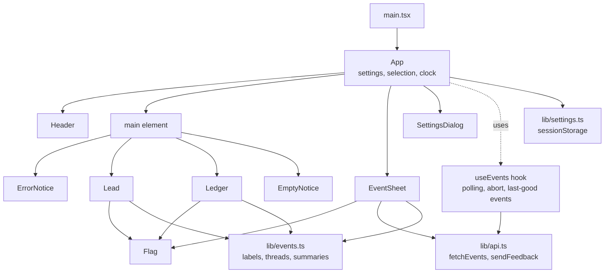
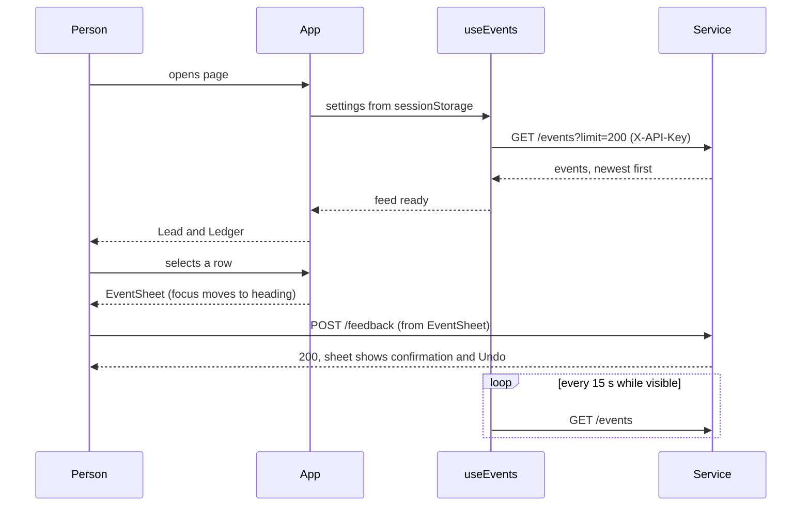

# UI architecture and design: the Attention console

Written for engineers who will change or extend `apps/web`. It explains how the console is built, why it looks the way it does, which component owns what, and where it falls short of the three UI skills in [`skills/`](../skills/README.md). The shorter product-level summary is [frontend.md](frontend.md); the backend contract is in [architecture.md](architecture.md) section 11.4a.

All statements here were checked against the code at the commit that added this file. Line references are to `apps/web/src`.

## Contents

1. [Scope](#1-scope)
2. [Stack and constraints](#2-stack-and-constraints)
3. [Component tree](#3-component-tree)
4. [Component reference](#4-component-reference)
5. [State and data flow](#5-state-and-data-flow)
6. [Design tokens](#6-design-tokens)
7. [Typography](#7-typography)
8. [Layout and wireframes](#8-layout-and-wireframes)
9. [CSS architecture](#9-css-architecture)
10. [Interaction states](#10-interaction-states)
11. [Motion](#11-motion)
12. [Accessibility](#12-accessibility)
13. [Copy rules](#13-copy-rules)
14. [Testing](#14-testing)
15. [Skills conformance audit](#15-skills-conformance-audit)
16. [Gaps and recommended order of work](#16-gaps-and-recommended-order-of-work)
17. [How to extend the console](#17-how-to-extend-the-console)

## 1. Scope

The console is a single-page operator view. It answers two questions: **what did the platform decide about each event, and why**, and **was that right**. It reads `GET /events` and writes `POST /feedback`. It does not manage rules, preferences or digests; those need backend work first.

There is one screen with three overlays that appear on demand: the detail sheet, the connection settings dialog and the error/empty notices (which replace the list rather than overlay it).

## 2. Stack and constraints

| Item | Choice | Reason |
|---|---|---|
| UI | React 18, TypeScript (strict) | Project stack in `AGENTS.md` |
| Build | Vite 5, `tsc -b` | Fast, minimal config |
| Tests | Vitest 2, node environment | Logic tests only; no DOM runner yet |
| Font | `@fontsource-variable/bricolage-grotesque`, self-hosted | One variable family; no third-party request at runtime |
| Styling | One hand-written `styles.css` with CSS custom properties | No build-time CSS tooling needed at this size (about 650 lines) |
| Runtime dependencies | `react`, `react-dom`, the font | Everything else is the platform (`fetch`, `<dialog>`, `sessionStorage`) |

Rules the code follows: components render, `lib/` holds logic and has the tests, only `lib/api.ts` calls `fetch`, and no component imports another component's styles.

## 3. Component tree



`App` is the only component with application state. Everything below it receives data and callbacks as props. `Flag` is the only shared visual component.

## 4. Component reference

| Component | File | Owns | Props | Notes |
|---|---|---|---|---|
| `App` | `App.tsx` | `settings`, `settingsOpen`, `selectedId`, `now` (30 s clock) | none | Derives `selected` and `original` (the event a merged one points to). Sets `data-sheet="open\|closed"` on `.page`, which switches the grid layout. |
| `Welcome` | `components/Welcome.tsx` | nothing | `onTryDemo`, `onConnect` | First-visit screen with the legend and two choices. Shown instead of an error when nothing has been configured. |
| `Legend` | `components/Legend.tsx` | nothing | none | The three classes with their flags and a plain sentence each. Used in `Welcome` and above the list. |
| `Header` | `components/Header.tsx` | nothing | `feed`, `onOpenSettings`, `inert?` | Wordmark, connection status (`role="status"`), link to settings. The status dot has three shapes: filled circle (connected), hollow circle (connecting), rotated diamond (problem), so state is not colour-only. |
| `Lead` | `components/Lead.tsx` | nothing | `events`, `now`, `onOpen` | The page's `h1`. Latest critical event as a button in the largest type, its reason, and one last-hour sentence. When there is no critical event it says so in a lighter, condensed face. |
| `Ledger` | `components/Ledger.tsx` | `filter` | `events`, `now`, `selectedId`, `onSelect` | Filter group (`aria-pressed` buttons with counts) and the thread list. Memoises counts and `groupThreads`. Each row is one `<button>`; merged events are nested buttons in a second list. |
| `EventSheet` | `components/EventSheet.tsx` | `last`, `error`, `busy`, `reply` | `event`, `original?`, `settings`, `onOpenOriginal`, `onClose` | Why, rule, class meaning, repeat link, feedback buttons, note form, confirmation with Undo. Moves focus to its heading on open and on event change, restores focus on close, closes on Escape. Hides "Never notify me" for critical events and says why. |
| `SettingsDialog` | `components/SettingsDialog.tsx` | form fields, `urlError` | `open`, `settings`, `onSave`, `onClose` | Native `<dialog>` opened with `showModal()`, so the browser supplies the focus trap, Escape and backdrop. Validates the address with `validateBackendUrl`. API key is a password field. |
| `ErrorNotice` | `components/Notices.tsx` | nothing | `error`, `settings`, `onOpenSettings`, `onRetry` | One branch per `ApiError.kind`; every branch names the cause and offers the next action. `role="alert"`. |
| `EmptyNotice` | `components/Notices.tsx` | `copied` | `settings` | Three real setup steps, the webhook URL and a copy button. The numbered list is a true sequence. |
| `Flag` | `components/Flag.tsx` | nothing | `kind` | CSS-drawn shape with `role="img"` and an accessible name. See [section 6](#6-design-tokens). |
| `useMediaQuery` | `hooks/useMediaQuery.ts` | match state | `query` | Used by `App` to know when the sheet covers the screen, so it can mark the page behind it `inert`. |
| `useEvents` | `hooks/useEvents.ts` | feed state, reload counter | `settings` | Loads on mount and when settings change, polls every 15 s while the tab is visible, reloads when the tab becomes visible, aborts superseded requests, keeps the last events on screen during an outage. |

### Demo mode and first run

`Settings.demo` switches `lib/api.ts` to `lib/demo.ts`: `fetchEvents` returns sample events and `sendFeedback` does nothing, so no network call is made. `needsWelcome()` is true on a first visit (nothing in `sessionStorage`, no `VITE_API_KEY`, and not a demo-default build). `App` holds `welcome`; while it is true `useEvents` is disabled and `Welcome` replaces the page. Saving connection settings or choosing the demo clears it. A hosted build sets `VITE_DEFAULT_DEMO=true`, so visitors land straight in demo mode.

### Feed state

```ts
type Feed =
  | { status: 'loading'; events: EventSummary[] }
  | { status: 'ready';   events: EventSummary[]; updatedAt: Date }
  | { status: 'error';   events: EventSummary[]; error: ApiError }
```

`events` is carried through every state on purpose: a failing poll shows the notice above the previous list instead of blanking the page.

## 5. State and data flow



| State | Lives in | Why there |
|---|---|---|
| Settings (address, key) | `App`, persisted by `lib/settings.ts` in `sessionStorage` | Changing them must restart the feed; the key must not outlive the tab |
| Selected event id | `App` | The layout (`data-sheet`) and the list highlight both depend on it |
| Clock `now` | `App`, updated every 30 s | Keeps "2 minutes ago" correct between polls; passed down so children stay pure |
| Filter | `Ledger` | Nothing else needs it |
| Feedback progress | `EventSheet` | Resets whenever the event changes |
| Dialog field values | `SettingsDialog` | Discarded on cancel |

There is no global store. Three pieces of shared state do not justify one.

### Error mapping

`lib/api.ts` converts every failure into an `ApiError` with a `kind`, so no screen shows a raw status code:

| Kind | Trigger | Screen |
|---|---|---|
| `unauthorized` | HTTP 401 | "The service rejected this API key." |
| `unconfigured` | HTTP 503 | "The service has no API key, so it refuses every request." |
| `unreachable` | network failure or CORS block | "Can't reach {address}." with the CORS setting to check |
| `rejected` | other 4xx | Inline message in the sheet, "Check the entry and try again." |
| `server` | 5xx | "The service hit an error." |

## 6. Design tokens

All tokens are CSS custom properties on `:root` ([styles.css](../apps/web/src/styles.css) lines 12 to 38).

### Colour

| Token | Hex | Role | Contrast on Harbour |
|---|---|---|---|
| `--harbour` | `#E6ECEE` | Page ground (cool grey, not cream) | n/a |
| `--deck` | `#F4F8F9` | Raised surfaces: sheet, selected and hovered rows, fields | n/a |
| `--sea` | `#10283B` | Ink, primary button, rules | about 12:1 |
| `--distress` | `#C8281F` | Critical, errors | about 4.9:1 |
| `--signal` | `#2058B8` | Standard, links, focus ring | about 5.7:1 |
| `--pennant` | `#E3B21C` | Merged events and the thread line | shapes only |
| `--fog` | `#8DA0AB` | Rules and the background-class outline | 2.4:1, **never text** |

### Flag shapes

| Kind | Shape (CSS) | Colour |
|---|---|---|
| critical | Triangle, `clip-path: polygon(0 0, 100% 50%, 0 100%)` | Distress |
| standard | Short filled rectangle | Signal |
| background | Thin rectangle, 2 px outline only | Fog |
| merged | Swallowtail, `clip-path: polygon(0 0, 100% 0, 72% 50%, 100% 100%, 0 100%)` | Pennant |

In `forced-colors: active` the three filled flags fall back to `CanvasText`.

### Spacing and scale

| Token | Value | | Token | Value |
|---|---|---|---|---|
| `--space-1` | 0.5rem | | `--step--1` | 0.875rem |
| `--space-2` | 1rem | | `--step-0` | 1rem |
| `--space-3` | 1.5rem | | `--step-1` | 1.25rem |
| `--space-4` | 2.5rem | | `--step-2` | 1.5625rem |
| `--space-5` | 4rem | | `--step-3` | 1.953rem |
| `--measure` | 62ch | | `--step-lead` | `clamp(2.4rem, 1.4rem + 4.6vw, 4.25rem)` |

The scale is a major third (ratio 1.25) from a 1 rem base. Prose is capped at `--measure`.

## 7. Typography

One family, **Bricolage Grotesque Variable**, loaded with its width axis. The axis is the design's main idea: type width and weight encode attention class, so the list can be read at a glance.

| Class | `font-stretch` | `font-weight` | Size | Row padding |
|---|---|---|---|---|
| Critical | 100% | 750 | `--step-3` | 1.4rem vertical |
| Standard | 90% | 500 | `--step-1` | 0.75rem vertical |
| Background | 78% | 350 | `--step-0` | 0.3rem vertical |

Other uses: wordmark 75% width at weight 800; lead 100% at 750; the calm lead ("Nothing critical has arrived.") 85% at 450; merged rows 85%. Everything is sentence case. There are no all-caps labels, no monospace face and no letter-spaced eyebrow text.

## 8. Layout and wireframes

One column, left-aligned, maximum width 60rem. No sidebar, no stat cards.

### Wide screen, nothing selected

```
+--------------------------------------------------------------+
| Attention                    (o) Connected   Connection settings
|                                                              |
| Payment failed in acme/billing        <- largest type, link  |
| Latest critical event, 4 minutes ago. Matched a critical rule|
| In the last hour: 2 sent to you, 5 held back, 3 merged.      |
|                                                              |
| All 24   Critical 3   Standard 9   Background 12             |
| ------------------------------------------------------------ |
| >  Payment failed in acme/billing      Sent        4 min ago |  tall row
| ------------------------------------------------------------ |
| #  Pull request opened in acme/web     Held back   9 min ago |  medium
|    |-- <> Repeat, merged into the event above      6 min ago |  thread line
| -  star created                        Held back  12 min ago |  slim
+--------------------------------------------------------------+
```

### Wide screen, event selected (62rem and up)

The page becomes a two-column grid; the sheet is sticky at 27rem and the list narrows beside it.

```
+------------------------------------------+------------------+
| Attention        (o) Connected  Settings | Close            |
| Lead ...                                 | Payment failed...|
| Filters                                  | Critical. Sent.  |
| rows ...                                 | Why this happened|
|                                          | Rule that matched|
|                                          | [Dismiss][Always]|
|                                          | Add a note [   ] |
+------------------------------------------+------------------+
```

### Phone (up to 40rem)

Rows stack into title, status and time. The sheet becomes a fixed full-screen layer (`position: fixed; inset: 0; z-index: 10`).

```
+------------------------+      +------------------------+
| Attention  (o) Connected      | Close                  |
| Settings               |      | Payment failed in ...  |
| Lead (large, wraps)    |      | Critical. Sent.        |
| All 24 Critical 3 ...  |      | Why this happened      |
| > Payment failed in .. |      | ...                    |
|   Sent                 |      | [Dismiss] [Always]     |
|   4 min ago            |      | Add a note             |
+------------------------+      +------------------------+
```

## 9. CSS architecture

- **Single-class selectors.** Components own a block name (`.row`, `.sheet`, `.notice`, `.dialog`) with a few elements (`.row-title`). Variation uses `data-*` attributes (`data-class`, `data-kind`, `data-state`, `data-sheet`) or ARIA state (`aria-pressed`, `aria-current`, `aria-invalid`), not modifier classes. The attribute that styles an element is the same one assistive technology reads.
- **No `!important`, no inline styles, no `transition: all`.** Nothing transitions today.
- **Order in the file:** tokens, reset, page frame, lead, ledger, flags, sheet, controls, dialog, notices, wide-screen rules, small-screen rules, motion.
- **Responsive rules** are two media queries (`min-width: 62rem` for the docked sheet, `max-width: 40rem` for stacked rows), plus a fluid lead size via `clamp`.
- **Page grid** uses named areas (`masthead`, `main`, `sheet`) so the sheet can dock without moving the DOM.

## 10. Interaction states

Hover styles apply only where the pointer can hover (`@media (hover: hover) and (pointer: fine)`), so a tap on a phone never leaves a control stuck in its hover look. Press feedback works on every input type.

| Surface | Default | Hover (mouse only) | Focus | Pressed | Disabled |
|---|---|---|---|---|---|
| `.button` | 2 px sea border, transparent | fills sea, text harbour (120 ms) | 3 px signal ring, 3 px offset | `scale(0.97)` | 50% opacity, `not-allowed` |
| `.button-primary` | sea fill | signal fill and border | same ring | `scale(0.97)` | same |
| `.text-button` | signal, underlined | thicker underline | same ring | `scale(0.97)` | same |
| `.filter` | regular weight | none | same ring | `scale(0.97)` | n/a |
| `.row`, `.merged-row` | transparent | deck background | same ring | `scale(0.99)` | n/a |
| `.lead-link` | underlined in distress | thicker underline | same ring | none (inline text; a transform has no effect) | n/a |
| Selected row | deck background and 4 px sea bar on the left (`aria-current`) | | | | |

Press and release use `transform 140ms` with the `--ease-out` curve. Rows scale less because they are wide.

Touch behaviour: `button` has `touch-action: manipulation` (no double-tap delay) and `user-select: none` (a long press does not select a label). `html` has `-webkit-tap-highlight-color: transparent` and `overscroll-behavior: none`. Text fields are not affected and stay selectable at 16 px.

Keyboard map:

| Key | Where | Effect |
|---|---|---|
| Tab / Shift+Tab | everywhere | Moves through filters, rows, then the sheet if open. When the sheet covers the screen (below 62rem) the page behind it is `inert`, so focus stays inside the sheet |
| Enter / Space | rows, buttons | Activates (all interactive elements are real buttons) |
| Escape | detail sheet | Closes it and returns focus to the row that opened it |
| Escape | settings dialog | Closes it (native `<dialog>`) |

## 11. Motion

One entrance animation exists: the detail sheet fades in and slides 1.5rem from the right over 180 ms using the `--ease-out` curve (`cubic-bezier(0.23, 1, 0.32, 1)`). It answers an action (opening an event) and shows where the content came from. It animates only `opacity` and `transform`.

Under `prefers-reduced-motion: reduce` the sheet keeps a fade (`sheet-fade`) and loses the movement, and the press scale is turned off. Reduced motion means gentler, not none: the fade still signals that something changed.

Everything else is small feedback: a 140 ms press scale and, on desktop only, a 120 ms colour change on buttons. Nothing animates on load, scroll or row hover. Closing the sheet is instant because it is often done with Escape, and keyboard-driven actions are not animated.

## 12. Accessibility

| Area | What is in place |
|---|---|
| Landmarks | `header`, `main`, `aside` (sheet, labelled by its heading), `section` regions with labels |
| Headings | `h1` is the lead; the sheet and notices use `h2`; sheet sections use `h3` |
| Focus | One visible ring for everything (`:focus-visible`, 3 px signal, offset 3 px). The sheet heading takes programmatic focus without a ring on mouse use and a ring on keyboard use |
| Focus management | Sheet focus moves in and is restored on close. Below 62rem, where the sheet covers the screen, the header and `main` are `inert` while it is open. Native `<dialog>` handles settings |
| Live regions | Connection text `role="status"`; feedback confirmation `role="status"`; errors `role="alert"` |
| Colour | Class is carried by shape and by name (`Flag` has `role="img"` and a label); the connection dot also changes shape |
| Contrast | Text is Sea (12:1), Distress (4.9:1) or Signal (5.7:1) on Harbour. Fog and Pennant never carry text |
| Forced colours | Filled flags use `CanvasText` |
| Zoom | The viewport meta does not block zoom; layout holds at 390 px and with larger text |
| Reduced motion | The sheet keeps a fade and loses the slide; press scaling is off |
| Forms | Every field has a label; the URL field exposes `aria-invalid` and `aria-describedby` |

Known weaknesses are in [section 16](#16-gaps-and-recommended-order-of-work).

## 13. Copy rules

- Sentence case; active voice; plain words. The service says "queued"; the console says "Held back".
- A button keeps its name through the flow: **Dismiss** produces "Dismissed."
- Errors do not apologise and always say the next action ("Enter API key", "Try again", "Change address").
- When the platform refuses an option, say why instead of hiding it: critical events show "Critical events can't be silenced, so there is no option to never be notified."

## 14. Testing

| Layer | Tooling | Count | Covers |
|---|---|---|---|
| `lib/api` | Vitest | in the 34 | URL joining, key header, every HTTP status mapped to a kind, network failure, abort passthrough |
| `lib/events` | Vitest | in the 34 | Labels, thread grouping with and without the original loaded, last-hour counts and boundary, sentences, relative time, plurals |
| `lib/settings` | Vitest | in the 34 | Defaults, round trip, corrupt and wrong-typed storage, URL validation |
| Components | none | 0 | Checked by hand in a browser at desktop and 390 px widths (list, sheet, feedback and Undo, settings, empty, 401 and unreachable states) |

The honest gap: no component or interaction tests, no automated accessibility check and no visual regression. Adding Testing Library with `jsdom` and `jest-axe` is the next step ([section 16](#16-gaps-and-recommended-order-of-work)).

## 15. Skills conformance audit

Three skills were added to [`skills/`](../skills/README.md). This section checks the console against each. "Verified" means read in the code or CSS. Nothing was tested on a physical phone.

**Result: the console meets the checkable rules of all three skills.** The first audit found 11 `mobile-native` failures and missing press feedback; they were fixed in the follow-up change recorded in [section 16](#16-gaps-and-recommended-order-of-work). What remains is verification on a physical phone.

### 15.1 `mobile-native`

| Rule | Status | Evidence |
|---|---|---|
| Never disable zoom | Pass | Viewport has no `user-scalable` or `maximum-scale` |
| Inputs at least 16 px (no iOS zoom on focus) | Pass | Measured 16px on the note field in a browser |
| Hover gated by `(hover: hover) and (pointer: fine)` | Pass | All six hover rules sit in one gated block. Verified: hover fills a button with a mouse; on an emulated touch device the query does not match |
| Tap highlight removed | Pass | `html { -webkit-tap-highlight-color: transparent }` |
| Press feedback on `:active` | Pass | `scale(0.97)` measured on a pressed button |
| `touch-action: manipulation` on controls | Pass | Computed value on `.button` is `manipulation` |
| `100dvh` instead of `100vh` | Pass | `body`, `.page` and the docked sheet use `100dvh` with a `100vh` fallback line above |
| `overscroll-behavior` | Pass | `none` on `html`; `contain` on `.sheet` (both measured) |
| `viewport-fit=cover` and safe-area insets | Pass | Meta added; header, main and sheet padding use `max(spacing, env(safe-area-inset-*))`. Insets are `0` on desktop, so this only shows on a notched phone |
| `user-select: none` on controls only | Pass | Set on `button`; text and fields stay selectable |
| `theme-color` | Pass | `#e6ecee` (Harbour, the colour at the top of the page). One value, because the console has no dark scheme |
| `interactive-widget=resizes-content` | Pass | In the viewport meta, so the keyboard shrinks the layout on Android |
| `-webkit-text-size-adjust: 100%` | Pass | Set on `html` |
| Carousel / `touch-action` | n/a | No carousels or custom gestures |
| Tested on real hardware | **Not done** | Checked only in Edge with emulated touch at 390 px. Sticky hover, the URL bar, safe-area insets and the keyboard need a physical phone |

### 15.2 `tarun-design-eng` (animation and polish)

Review of the first audit, in the skill's required format. Status shows what was done.

| Before | After | Why | Status |
|---|---|---|---|
| Buttons, rows and text buttons had no `:active` state | `transform: scale(0.97)` (rows 0.99), 140 ms `ease-out` | Controls should acknowledge a press; also the touch feedback once hover is gated | Done |
| `animation: sheet-in 180ms ease-out` | Same duration with `cubic-bezier(0.23, 1, 0.32, 1)` as `--ease-out` | Built-in `ease-out` is weak; the custom curve gives more punch at the same length | Done |
| Under reduced motion the sheet appeared with no effect | Opacity fade kept, translate dropped | Reduced motion means gentler, not none | Done |
| Hover colour changes were instant | `background-color 120ms ease, color 120ms ease` inside the hover-capable query | Instant swaps read as abrupt on desktop; kept off touch | Done |
| Ungated hover rules | One `@media (hover: hover) and (pointer: fine)` block | Touch triggers hover on tap | Done |
| `@keyframes` for the sheet | Leave as is | Switching rows does not remount the sheet, so interruption is not an issue today | Not changed, by choice |
| `.sheet` closes with no exit animation | Leave | Closing is often keyboard-driven; the skill says never animate those | Not changed, by choice |
| `.lead-link` has no press scale | Leave | It is inline text inside a heading; making it `inline-block` would change how the headline wraps | Not changed, by choice |

What already matched the skill:

| Principle | Status |
|---|---|
| Decide by frequency: no animation for list navigation | Pass. Rows and filters do not animate |
| Every animation has a purpose | Pass |
| Under 300 ms | Pass (180 ms entrance, 140 ms press) |
| Only `transform` and `opacity` for movement | Pass |
| Never `transition: all`, never `scale(0)` | Pass. Each transition names its properties; the sheet starts at `translateX(1.5rem)` with opacity 0 |
| No `ease-in` | Pass |
| No animation on keyboard actions | Pass (Escape closes instantly) |
| Reduced motion respected | Pass |

### 15.3 `pick-ui-library`

This skill picks libraries; it does not prescribe code. Checked against `package.json`:

| Task in the console | Skill's pick | What the console uses | Verdict |
|---|---|---|---|
| Dialogs, popovers, menus | base-ui | Native `<dialog>` for settings; a hand-written sheet | Settings is fine. The sheet still does its own focus handling (see the note below) |
| Toasts | Sonner | None; confirmation is inline text with Undo | Fine. An inline status next to the action is clearer than a toast here |
| Long lists | Virtuoso | A plain list capped at 200 rows | Fine until pagination raises the cap |
| Shared state | zustand | `useState` in `App`, props down | Fine; three pieces of shared state |
| Conditional class names | clsx / cva | State via `data-*` and ARIA attributes, no ternaries | Fine |
| Animation | motion | One CSS animation | Fine; motion is for springs and layout animation, which are not needed |
| Charts, numbers, command menu, drag and drop | recharts, NumberFlow, cmdk, dnd kit | None needed | n/a |

No competing library is installed, so there is nothing to flag or replace. The sheet's focus handling is hand-written, which the skill flags as a case for base-ui. It is a small amount of code (focus in, focus back, Escape) and the phone case is now covered by `inert` on the page behind it, so no dependency was added. If the sheet grows (nested menus, popovers), switch to base-ui's Dialog at that point.

## 16. Gaps and recommended order of work

### Done in the follow-up change

| # | Change | Skill |
|---|---|---|
| 1 | All hover rules moved into `@media (hover: hover) and (pointer: fine)` | mobile-native, tarun-design-eng |
| 2 | `:active` press scale on buttons, text buttons, filters and rows | both |
| 3 | Tap highlight off, `overscroll-behavior` on `html` and the sheet, `touch-action: manipulation` on buttons | mobile-native |
| 4 | `100dvh` for the page, body and docked sheet | mobile-native |
| 5 | `user-select: none` on buttons only | mobile-native |
| 6 | `viewport-fit=cover`, `interactive-widget=resizes-content`, `theme-color`, `color-scheme`, safe-area padding | mobile-native |
| 7 | Custom ease-out curve; fade kept under reduced motion; short colour transition on desktop hover | tarun-design-eng |
| 8 | Page behind the full-screen sheet is `inert` (new `useMediaQuery` hook; `inert` prop on `Header` and `main`) | accessibility |

Verified in Edge: the page behind the sheet is inert on a 390 px viewport and Tab stays inside it; closing restores focus to the row and removes `inert`; on desktop nothing is inert and the sheet docks; hover and press behave as described in [section 10](#10-interaction-states); the reduced-motion animation is `sheet-fade`. 34 unit tests, `tsc` and the production build pass.

### Still open

| # | Change | Effort |
|---|---|---|
| 9 | Add Testing Library, `jsdom` and `jest-axe`; test the sheet's focus handling, the Never-hidden-for-critical rule, filters and notices | 2 to 3 hours |
| 10 | Test on a real phone over the LAN (Safari Web Inspector or `chrome://inspect`): sticky hover, press feel, URL bar height, keyboard, safe areas | 30 minutes |
| 11 | Keep `inert` in step with the settings dialog if it ever becomes non-modal | only if changed |
| 12 | A dark colour scheme would need a second `theme-color` and tokens | only if wanted |

## 17. How to extend the console

| To add | Do this |
|---|---|
| A new event field in the list | Add it to the Go `eventSummary`, to `EventSummary` in `lib/api.ts`, then render it in `Ledger` or `EventSheet`. Keep raw payloads out of the list endpoint |
| A new attention class | Add it to `AttentionClass`, `CLASS_LABELS`, `CLASS_EXPLANATIONS`, `Flag`'s names, a `data-kind` flag shape and a `data-class` row rule. Give it its own width, weight and shape; never rely on colour alone |
| A new error | Add an `ApiErrorKind`, map it in `lib/api.ts` with a test, and add a branch in `ErrorNotice` that states the cause and the next action |
| A new feedback action | Add it to `FeedbackAction` and `DONE_TEXT`, add a button in `EventSheet`, and confirm the backend accepts it. If it silences anything, check the critical-event rule |
| A new setting | Add it to `Settings`, `lib/settings.ts` (with a test for corrupt storage) and `SettingsDialog` |
| Pagination or search | Add cursor parameters to `GET /events` first; then extend `fetchEvents` and `useEvents`. Virtuoso becomes worthwhile above about 1,000 rendered rows |
| A new colour | Add it as a token with its role and contrast. If it would carry text, check 4.5:1 on Harbour first |

Before merging UI changes: `npm test`, `npm run build`, keyboard-only pass, a look at 390 px width, and the checks in [section 15](#15-skills-conformance-audit).
