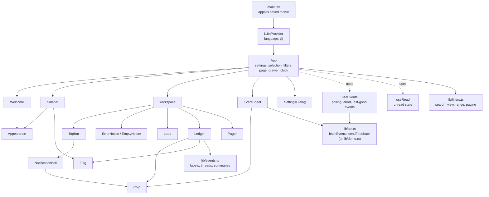
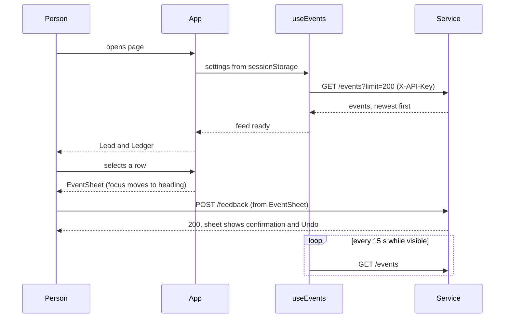

# UI architecture and design: the Attention console

Written for engineers who will change or extend `apps/web`. It explains how the console is built, why it looks the way it does, which component owns what, and where it falls short of the three UI skills in [`skills/`](../skills/README.md). The shorter product-level summary is [frontend.md](frontend.md); the backend contract is in [architecture.md](architecture.md) section 11.4a.

This document describes the console after the inbox redesign (sidebar, search, unread, themes and languages). Sections 15 and 16 record the earlier skills audit, which still applies; new controls follow the same rules.

All statements here were checked against the code at the commit that added this file. Line references are to `apps/web/src`.

## Contents

1. [Scope](#1-scope)
2. [Stack and constraints](#2-stack-and-constraints)
3. [Component tree](#3-component-tree)
4. [Component reference](#4-component-reference)
5. [State and data flow](#5-state-and-data-flow)
6. [Design tokens](#6-design-tokens)
7. [Typography](#7-typography)
8. [Layout and wireframes](#8-layout-and-wireframes)
9. [CSS architecture](#9-css-architecture)
10. [Interaction states](#10-interaction-states)
11. [Motion](#11-motion)
12. [Accessibility](#12-accessibility)
13. [Copy rules](#13-copy-rules)
14. [Testing](#14-testing)
    - [14a. Languages, themes and categories](#14a-languages-themes-and-categories)
15. [Skills conformance audit](#15-skills-conformance-audit)
16. [Gaps and recommended order of work](#16-gaps-and-recommended-order-of-work)
17. [How to extend the console](#17-how-to-extend-the-console)

## 1. Scope

The console is a single-page operator view. It answers two questions: **what did the platform decide about each event, and why**, and **was that right**. It reads `GET /events` and writes `POST /feedback`. It does not manage rules, preferences or digests; those need backend work first.

There is one screen with three overlays that appear on demand: the detail sheet, the connection settings dialog and the error/empty notices (which replace the list rather than overlay it).

## 2. Stack and constraints

| Item | Choice | Reason |
|---|---|---|
| UI | React 18, TypeScript (strict) | Project stack in `AGENTS.md` |
| Build | Vite 5, `tsc -b` | Fast, minimal config |
| Tests | Vitest 2, node environment | Logic tests only; no DOM runner yet |
| Font | `@fontsource-variable/bricolage-grotesque`, self-hosted | One variable family; no third-party request at runtime |
| Styling | One hand-written `styles.css` with CSS custom properties | No build-time CSS tooling needed at this size (about 650 lines) |
| Runtime dependencies | `react`, `react-dom`, the font | Everything else is the platform (`fetch`, `<dialog>`, `sessionStorage`) |

Rules the code follows: components render, `lib/` holds logic and has the tests, only `lib/api.ts` calls `fetch`, and no component imports another component's styles.

## 3. Component tree



`App` is the only component with application state. Everything below it receives data and callbacks as props. Every visible string goes through `t()` from `I18nProvider`.

## 4. Component reference

| Component | File | Owns | Notes |
|---|---|---|---|
| `App` | `App.tsx` | `settings`, `settingsOpen`, `selectedId`, `now`, `welcome`, `filters` (view, query, range), `pageNumber`, `drawerOpen` | Derives counts, filtered threads, the current page and the unread list. Marks the page behind a covering layer `inert`. |
| `Welcome` | `components/Welcome.tsx` | nothing | First-visit screen: purpose, the legend, **Try the demo**, **Connect your service**, language and theme. |
| `Sidebar` | `components/Sidebar.tsx` | nothing | Wordmark, the four **views** (All, Critical, Standard, Background) with counts, connection status, **Connection settings**, and `Appearance`. A fixed column from 62rem; a drawer below that (focus moves in, Escape closes, a scrim behind). |
| `TopBar` | `components/TopBar.tsx` | nothing | Menu button (small screens), search box, time-range control (1h, 24h, 7d, All) and the bell. Sticky. |
| `NotificationBell` | `components/NotificationBell.tsx` | `open` | Bell with an unread badge. Opens a popover of the five latest unread events with **Mark all as read** and **View all**. Closes on Escape (focus returns to the bell) or an outside press. |
| `Lead` | `components/Lead.tsx` | nothing | Banner: the latest critical event, its reason and one last-hour sentence. A calm message when there is no critical event. |
| `Ledger` | `components/Ledger.tsx` | nothing | The list for the current page. Row = flag, title, reason, coloured `Chip`, status, time, unread dot. Merged events nest on a thread line. Empty result offers **Clear search and filters**. |
| `Pager` | `components/Pager.tsx` | nothing | Previous, "Page 2 of 5", Next. Hidden when there is one page. |
| `EventSheet` | `components/EventSheet.tsx` | `last`, `error`, `busy`, `reply` | Why, rule, class meaning, repeat link, **Was this right?** choices with explanations, note form, confirmation with Undo. Focus in on open and on event change, restored on close, Escape closes. No "Never notify me" for critical events. |
| `SettingsDialog` | `components/SettingsDialog.tsx` | form fields, `urlError` | Native `<dialog>` with `showModal()`. Validates the address; the key is a password field. |
| `ErrorNotice`, `EmptyNotice` | `components/Notices.tsx` | `copied` | One branch per `ApiError.kind`, each naming the cause and the next action. Empty state gives three setup steps. |
| `Appearance` | `components/Appearance.tsx` | `theme` | Language select and five colour-theme swatches (radio group). Applies at once and persists. |
| `Chip` | `components/Chip.tsx` | nothing | Coloured label for the event category. |
| `Legend` | `components/Legend.tsx` | nothing | The three classes with flag and a plain sentence each. |
| `Flag` | `components/Flag.tsx` | nothing | CSS-drawn shape; accessible name from the language, or hidden when a label sits beside it. |
| `useEvents` | `hooks/useEvents.ts` | feed state | Loads, polls every 15 s while visible, aborts superseded requests, keeps the last events during an outage, can be disabled (welcome screen). |
| `useRead` | `hooks/useRead.ts` | set of opened ids | Opened events are read; stored in `localStorage` (newest 2,000 ids). Not sent to the service. |
| `useMediaQuery` | `hooks/useMediaQuery.ts` | match state | Tells `App` when the sheet covers the screen (below 80rem) and when the sidebar is a drawer (below 62rem). |

### Demo mode and first run

`Settings.demo` switches `lib/api.ts` to `lib/demo.ts`: `fetchEvents` returns sample events and `sendFeedback` does nothing, so no network call is made. `needsWelcome()` is true on a first visit (nothing in `sessionStorage`, no `VITE_API_KEY`, and not a demo-default build). `App` holds `welcome`; while it is true `useEvents` is disabled and `Welcome` replaces the page. Saving connection settings or choosing the demo clears it. A hosted build sets `VITE_DEFAULT_DEMO=true`, so visitors land straight in demo mode.

### Feed state

```ts
type Feed =
  | { status: 'loading'; events: EventSummary[] }
  | { status: 'ready';   events: EventSummary[]; updatedAt: Date }
  | { status: 'error';   events: EventSummary[]; error: ApiError }
```

`events` is carried through every state on purpose: a failing poll shows the notice above the previous list instead of blanking the page.

## 5. State and data flow



| State | Lives in | Why there |
|---|---|---|
| Settings (address, key) | `App`, persisted by `lib/settings.ts` in `sessionStorage` | Changing them must restart the feed; the key must not outlive the tab |
| Selected event id | `App` | The layout (`data-sheet`) and the list highlight both depend on it |
| Clock `now` | `App`, updated every 30 s | Keeps "2 minutes ago" correct between polls; passed down so children stay pure |
| Filters (view, search, range) and page number | `App` | The sidebar, top bar, list and pager all read them |
| Unread ids | `useRead`, `localStorage` | Shared by the list, the badge and the bell; kept in this browser |
| Language, theme | `I18nProvider`, `Appearance`, `localStorage` | Apply at once and persist |
| Feedback progress | `EventSheet` | Resets whenever the event changes |
| Dialog field values | `SettingsDialog` | Discarded on cancel |

There is no global store. Three pieces of shared state do not justify one.

### Error mapping

`lib/api.ts` converts every failure into an `ApiError` with a `kind`, so no screen shows a raw status code:

| Kind | Trigger | Screen |
|---|---|---|
| `unauthorized` | HTTP 401 | "The service rejected this API key." |
| `unconfigured` | HTTP 503 | "The service has no API key, so it refuses every request." |
| `unreachable` | network failure or CORS block | "Can't reach {address}." with the CORS setting to check |
| `rejected` | other 4xx | Inline message in the sheet, "Check the entry and try again." |
| `server` | 5xx | "The service hit an error." |

## 6. Design tokens

All tokens are CSS custom properties on `:root` ([styles.css](../apps/web/src/styles.css) lines 12 to 38).

### Colour

| Token | Hex | Role | Contrast on Harbour |
|---|---|---|---|
| `--harbour` | `#E6ECEE` | Page ground (cool grey, not cream) | n/a |
| `--deck` | `#F4F8F9` | Raised surfaces: sheet, selected and hovered rows, fields | n/a |
| `--sea` | `#10283B` | Ink, primary button, rules | about 12:1 |
| `--distress` | `#C8281F` | Critical, errors | about 4.9:1 |
| `--signal` | `#2058B8` | Standard, links, focus ring | about 5.7:1 |
| `--pennant` | `#E3B21C` | Merged events and the thread line | shapes only |
| `--fog` | `#8DA0AB` | Rules and the background-class outline | 2.4:1, **never text** |

### Flag shapes

| Kind | Shape (CSS) | Colour |
|---|---|---|
| critical | Triangle, `clip-path: polygon(0 0, 100% 50%, 0 100%)` | Distress |
| standard | Short filled rectangle | Signal |
| background | Thin rectangle, 2 px outline only | Fog |
| merged | Swallowtail, `clip-path: polygon(0 0, 100% 0, 72% 50%, 100% 100%, 0 100%)` | Pennant |

In `forced-colors: active` the three filled flags fall back to `CanvasText`.

### Spacing and scale

| Token | Value | | Token | Value |
|---|---|---|---|---|
| `--space-1` | 0.5rem | | `--step--1` | 0.875rem |
| `--space-2` | 1rem | | `--step-0` | 1rem |
| `--space-3` | 1.5rem | | `--step-1` | 1.25rem |
| `--space-4` | 2.5rem | | `--step-2` | 1.5625rem |
| `--space-5` | 4rem | | `--step-3` | 1.953rem |
| `--measure` | 62ch | | `--step-lead` | `clamp(2.4rem, 1.4rem + 4.6vw, 4.25rem)` |

The scale is a major third (ratio 1.25) from a 1 rem base. Prose is capped at `--measure`.

## 7. Typography

One family, **Bricolage Grotesque Variable**, loaded with its width axis. The axis is the design's main idea: type width and weight encode attention class, so the list can be read at a glance.

| Class | `font-stretch` | `font-weight` | Size | Row padding |
|---|---|---|---|---|
| Critical | 100% | 750 | `--step-3` | 1.4rem vertical |
| Standard | 90% | 500 | `--step-1` | 0.75rem vertical |
| Background | 78% | 350 | `--step-0` | 0.3rem vertical |

Other uses: wordmark 75% width at weight 800; lead 100% at 750; the calm lead ("Nothing critical has arrived.") 85% at 450; merged rows 85%. Everything is sentence case. There are no all-caps labels, no monospace face and no letter-spaced eyebrow text.

## 8. Layout and wireframes

Three regions: a **sidebar** of views, a **workspace** (top bar and the list) and the **detail sheet**. Widths decide how they combine:

| Width | Sidebar | Detail sheet |
|---|---|---|
| 80rem and up (1280 px) | Fixed column, 16rem | Docks as a third column, 27rem |
| 62rem to 80rem | Fixed column | Covers the screen (page behind is `inert`) |
| Below 62rem | Drawer opened from the menu button | Covers the screen |
| Below 40rem | Drawer | Covers; search wraps to its own line; rows stack |

### Wide screen, event selected

```
+----------+------------------------------------------+-----------------+
| Attention| [Search events]  [1h 24h 7d All]   (bell 3)| Close          |
|          | Notifications (3)        Mark all as read | Security advisory|
| > All 18 | +--------------------------------------+ | Critical. Sent. |
|   Crit. 3| | Security advisory in acme/billing    | | Why this happened|
|   Std. 10| | Latest critical event, 4 min. ago.   | | Rule that matched|
|   Bkg.  5| +--------------------------------------+ | Was this right? |
|          | Select an event to see why ...           | [Dismiss]       |
|          | > Security advisory in acme/billing  [Security] * | [Always notify]|
|          |   Security vulnerability detected  Sent  4 min   | Add a note      |
|          |   Pull request in acme/web        [Code]   *     |                 |
| Connected|     |-- <> Repeat, merged ...                    |                 |
| Settings |   Page 1 of 2   [Previous] [Next]                |                 |
| Language |                                                  |                 |
| (o)(o)(o)|                                                  |                 |
+----------+--------------------------------------------------+-----------------+
```

`*` is the orange unread dot. Chips are coloured by category (see section 6).

### Phone

```
+------------------------+   +------------------------+
| [=] [bell 3]           |   | Attention          [x] |
| [Search events        ]|   | > All            18    |
| [1h 24h 7d All]        |   |   Critical        3    |
| Notifications (3)      |   |   Standard       10    |
| Lead banner            |   |   Background      5    |
| > Security advisory *  |   |                        |
|   [Security] Sent 4 min|   | Connected              |
|   Pull request  *      |   | Connection settings    |
|   [Code] Held back     |   | Language [English v]   |
| Page 1 of 2 [<] [>]    |   | Colour theme (o)(o)(o) |
+------------------------+   +------------------------+
        list                       drawer (menu button)
```

## 9. CSS architecture

- **Single-class selectors.** Components own a block name (`.row`, `.sheet`, `.sidebar`, `.popover`, `.chip`). Variation uses `data-*` attributes (`data-class`, `data-kind`, `data-category`, `data-state`, `data-sheet`, `data-open`, `data-unread`) or ARIA state (`aria-pressed`, `aria-current`, `aria-invalid`), not modifier classes.
- **Themes are variables.** `:root` holds the default (Harbour); `:root[data-theme='...']` overrides surface, ink, accent and rule colours. Components never hard-code a colour.
- **No `!important`, no `transition: all`.** Inline styles appear only for the theme swatches, whose colours come from `lib/theme.ts`.
- **Order in the file:** tokens and themes, reset, frame (sidebar, appearance, top bar, main), lead, ledger, chips, flags, pager, sheet, controls, dialog, notices, welcome, width rules, hover, press, motion.
- **Layout** is a CSS grid on `.app` whose columns change by media query (section 8). The sheet is `position: fixed` when it covers the screen and `position: sticky` in its own column when docked.

## 10. Interaction states

Hover styles apply only where the pointer can hover (`@media (hover: hover) and (pointer: fine)`), so a tap on a phone never leaves a control stuck in its hover look. Press feedback works on every input type.

| Surface | Default | Hover (mouse only) | Focus | Pressed | Disabled |
|---|---|---|---|---|---|
| `.button` | 2 px sea border, transparent | fills sea, text harbour (120 ms) | 3 px signal ring, 3 px offset | `scale(0.97)` | 50% opacity, `not-allowed` |
| `.button-primary` | sea fill | signal fill and border | same ring | `scale(0.97)` | same |
| `.text-button` | signal, underlined | thicker underline | same ring | `scale(0.97)` | same |
| `.filter` | regular weight | none | same ring | `scale(0.97)` | n/a |
| `.row`, `.merged-row` | transparent | deck background | same ring | `scale(0.99)` | n/a |
| `.lead-link` | underlined in distress | thicker underline | same ring | none (inline text; a transform has no effect) | n/a |
| Selected row | deck background and 4 px sea bar on the left (`aria-current`) | | | | |

Press and release use `transform 140ms` with the `--ease-out` curve. Rows scale less because they are wide.

Touch behaviour: `button` has `touch-action: manipulation` (no double-tap delay) and `user-select: none` (a long press does not select a label). `html` has `-webkit-tap-highlight-color: transparent` and `overscroll-behavior: none`. Text fields are not affected and stay selectable at 16 px.

Keyboard map:

| Key | Where | Effect |
|---|---|---|
| Tab / Shift+Tab | everywhere | Moves through the sidebar, search, range, bell, rows and pager, then the sheet if open. When the sheet covers the screen (below 80rem) or the drawer is open, the page behind it is `inert`, so focus stays inside the layer |
| Enter / Space | rows, buttons | Activates (all interactive elements are real buttons) |
| Escape | detail sheet | Closes it and returns focus to the row that opened it |
| Escape | settings dialog | Closes it (native `<dialog>`) |

## 11. Motion

One entrance animation exists: the detail sheet fades in and slides 1.5rem from the right over 180 ms using the `--ease-out` curve (`cubic-bezier(0.23, 1, 0.32, 1)`). It answers an action (opening an event) and shows where the content came from. It animates only `opacity` and `transform`.

Under `prefers-reduced-motion: reduce` the sheet keeps a fade (`sheet-fade`) and loses the movement, and the press scale is turned off. Reduced motion means gentler, not none: the fade still signals that something changed.

Everything else is small feedback: a 140 ms press scale and, on desktop only, a 120 ms colour change on buttons. Nothing animates on load, scroll or row hover. Closing the sheet is instant because it is often done with Escape, and keyboard-driven actions are not animated.

## 12. Accessibility

| Area | What is in place |
|---|---|
| Landmarks | `aside` (sidebar), `nav` (views), `header` (top bar), `search`, `main`, `aside` (sheet, labelled by its heading), labelled regions |
| Headings | `h1` is the page title ("Notifications"); the lead, sheet and notices use `h2`; sheet sections `h3`. The welcome page has its own `h1` |
| Focus | One visible ring for everything (`:focus-visible`, 3 px accent). The search box shows the ring on `:focus-within` |
| Focus management | Sheet: focus in, restored on close. Drawer: focus to its close button, Escape closes. Bell: Escape closes and returns focus to the bell. Settings: native `<dialog>` |
| Covering layers | While the sheet covers the screen, or the drawer is open, the page behind is `inert` |
| Live regions | Connection text and feedback confirmation `role="status"`; errors `role="alert"`; the pager's "Page x of y" `aria-live="polite"` |
| Names | The bell says "Unread notifications: 17"; unread dots have a name; flags have names; icon-only buttons have labels; each field has a label |
| Colour | Class is carried by shape and name; category is carried by the chip's text, so colour is never the only signal; the connection dot changes shape |
| Contrast | Ink, accent and distress text are at least 4.5:1 on the page and raised surfaces in all five themes; chip text is at least 5.2:1 on its tint (checked by calculation). Fog and Pennant never carry text |
| Language | `<html lang>` follows the chosen language; each language option is marked with its own `lang` |
| Forced colours | Filled flags use `CanvasText` |
| Reduced motion | The sheet and drawer keep a fade and lose the slide; press scaling is off |
| Touch | 16 px inputs, `touch-action: manipulation`, hover gated to hover-capable pointers |

## 13. Copy rules

- Sentence case; active voice; plain words. The service says "queued"; the console says "Held back".
- A button keeps its name through the flow: **Dismiss** produces "Dismissed."
- Errors do not apologise and always say the next action ("Enter API key", "Try again", "Change address").
- When the platform refuses an option, say why instead of hiding it: critical events show "Critical events can't be silenced, so there is no option to never be notified."

## 14. Testing

| Layer | Tooling | Covers |
|---|---|---|
| `lib/api`, `lib/demo` | Vitest | URL joining, key header, every HTTP status mapped to a kind, network failure, abort; sample data shape, demo mode makes no network call |
| `lib/events` | Vitest | Labels, thread grouping, last-hour counts and sentence, relative time, plurals |
| `lib/filters` | Vitest | View, time range, multi-word search (case, status, category, current language), combined filters, counts, paging and clamping, category mapping, unread storage |
| `lib/i18n` | Vitest | Every language defines exactly the English keys and keeps every `{placeholder}`; no empty text; interpolation; locale detection; translated helpers; reasons; `Intl` relative time |
| `lib/settings` | Vitest | Defaults, round trip, corrupt storage, demo flag, first-visit detection, URL validation keys |
| Components | none | Checked in a browser: all five themes, three languages, welcome and demo, search, views, range, paging, mark all read, the bell, the drawer and focus, the docked and covering sheet, 1440, 800 and 390 px widths. No console errors |

77 unit tests. The honest gap: no component or interaction tests, no automated accessibility check and no visual regression. Testing Library with `jsdom` and `jest-axe` is the next step.

## 14a. Languages, themes and categories

### Languages

English, Spanish and Hindi. `lib/i18n/en.ts` is the source of truth; `es.ts` and `hi.ts` are typed `Messages`, so a missing key is a compile error, and a test checks keys and placeholders again. `t(key, {values})` fills `{name}` values; a key missing at run time falls back to English, then to the key itself so the gap is visible. The choice is saved in `localStorage`; the first visit follows the browser's language. Dates, times and "5 min. ago" use `Intl`, so they follow the language too.

Not translated: decision reasons from the service that this console does not know. Known reasons (security, dependency, social signal, standard hold-back, duplicate of ...) are mapped; anything else is shown as the service wrote it. Translations were written by the assistant and should be reviewed by native speakers before release.

To add a language (nine are supported; Arabic is right to left, see [milestone-15.md](milestone-15.md) commit 4): copy `en.ts` to `<code>.ts` and translate the values, add it to `Locale`, `LOCALES` and `CATALOGS` in `lib/i18n/index.ts`, and update the locale-count test. If its script is missing from Bricolage Grotesque (Devanagari, Telugu, Arabic and others), add a fallback font to `--font`.

### Colour themes

Five, chosen with the swatches in the sidebar (or on the welcome screen): Harbour (default), Violet, Forest, Sunset and Night. A theme sets the page, raised surface, ink, accent and rule colours. Red keeps meaning "critical" in every theme. The first visit follows the system's dark setting (Night); the choice is saved and applied before first paint, and the browser's address-bar colour follows it.

| Theme | Page | Ink | Accent |
|---|---|---|---|
| Harbour | `#E6ECEE` | `#10283B` | `#2058B8` |
| Violet | `#ECE9F6` | `#241B4B` | `#5B3FD0` |
| Forest | `#E7EFE8` | `#12301F` | `#17734A` |
| Sunset | `#F4E9EE` | `#3B1030` | `#A3195B` |
| Night | `#0F1B26` | `#E6EEF2` | `#7FB0FF` |

### Categories (the multicolour part)

Each event type belongs to a category shown as a coloured chip: Security (red), Code (blue), Issues (violet), Builds (teal), Releases (green), Social (amber) and Other (grey). Colour says what kind of event it is; the flag's shape and the row's size say how much it matters. Light and dark themes each have a tuned set so the chip text stays readable.

### Search, views, range, paging and unread

All of it works on the events already loaded (the newest 200). The sidebar views filter by class; the search matches every word against the title, event type, repository, status, reason and category in the current language; the range keeps the last hour, day or week; the list shows 10 threads per page. An event is **unread** until it is opened (or **Mark all as read** is used); the badge counts unread events, not repeats merged into an earlier one. Read state is kept in this browser only.

## 15. Skills conformance audit

Three skills were added to [`skills/`](../skills/README.md). This section checks the console against each. "Verified" means read in the code or CSS. Nothing was tested on a physical phone.

**Result: the console meets the checkable rules of all three skills.** The first audit found 11 `mobile-native` failures and missing press feedback; they were fixed in the follow-up change recorded in [section 16](#16-gaps-and-recommended-order-of-work). What remains is verification on a physical phone.

### 15.1 `mobile-native`

| Rule | Status | Evidence |
|---|---|---|
| Never disable zoom | Pass | Viewport has no `user-scalable` or `maximum-scale` |
| Inputs at least 16 px (no iOS zoom on focus) | Pass | Measured 16px on the note field in a browser |
| Hover gated by `(hover: hover) and (pointer: fine)` | Pass | All six hover rules sit in one gated block. Verified: hover fills a button with a mouse; on an emulated touch device the query does not match |
| Tap highlight removed | Pass | `html { -webkit-tap-highlight-color: transparent }` |
| Press feedback on `:active` | Pass | `scale(0.97)` measured on a pressed button |
| `touch-action: manipulation` on controls | Pass | Computed value on `.button` is `manipulation` |
| `100dvh` instead of `100vh` | Pass | `body`, `.page` and the docked sheet use `100dvh` with a `100vh` fallback line above |
| `overscroll-behavior` | Pass | `none` on `html`; `contain` on `.sheet` (both measured) |
| `viewport-fit=cover` and safe-area insets | Pass | Meta added; header, main and sheet padding use `max(spacing, env(safe-area-inset-*))`. Insets are `0` on desktop, so this only shows on a notched phone |
| `user-select: none` on controls only | Pass | Set on `button`; text and fields stay selectable |
| `theme-color` | Pass | `#e6ecee` (Harbour, the colour at the top of the page). One value, because the console has no dark scheme |
| `interactive-widget=resizes-content` | Pass | In the viewport meta, so the keyboard shrinks the layout on Android |
| `-webkit-text-size-adjust: 100%` | Pass | Set on `html` |
| Carousel / `touch-action` | n/a | No carousels or custom gestures |
| Tested on real hardware | **Not done** | Checked only in Edge with emulated touch at 390 px. Sticky hover, the URL bar, safe-area insets and the keyboard need a physical phone |

### 15.2 `tarun-design-eng` (animation and polish)

Review of the first audit, in the skill's required format. Status shows what was done.

| Before | After | Why | Status |
|---|---|---|---|
| Buttons, rows and text buttons had no `:active` state | `transform: scale(0.97)` (rows 0.99), 140 ms `ease-out` | Controls should acknowledge a press; also the touch feedback once hover is gated | Done |
| `animation: sheet-in 180ms ease-out` | Same duration with `cubic-bezier(0.23, 1, 0.32, 1)` as `--ease-out` | Built-in `ease-out` is weak; the custom curve gives more punch at the same length | Done |
| Under reduced motion the sheet appeared with no effect | Opacity fade kept, translate dropped | Reduced motion means gentler, not none | Done |
| Hover colour changes were instant | `background-color 120ms ease, color 120ms ease` inside the hover-capable query | Instant swaps read as abrupt on desktop; kept off touch | Done |
| Ungated hover rules | One `@media (hover: hover) and (pointer: fine)` block | Touch triggers hover on tap | Done |
| `@keyframes` for the sheet | Leave as is | Switching rows does not remount the sheet, so interruption is not an issue today | Not changed, by choice |
| `.sheet` closes with no exit animation | Leave | Closing is often keyboard-driven; the skill says never animate those | Not changed, by choice |
| `.lead-link` has no press scale | Leave | It is inline text inside a heading; making it `inline-block` would change how the headline wraps | Not changed, by choice |

What already matched the skill:

| Principle | Status |
|---|---|
| Decide by frequency: no animation for list navigation | Pass. Rows and filters do not animate |
| Every animation has a purpose | Pass |
| Under 300 ms | Pass (180 ms entrance, 140 ms press) |
| Only `transform` and `opacity` for movement | Pass |
| Never `transition: all`, never `scale(0)` | Pass. Each transition names its properties; the sheet starts at `translateX(1.5rem)` with opacity 0 |
| No `ease-in` | Pass |
| No animation on keyboard actions | Pass (Escape closes instantly) |
| Reduced motion respected | Pass |

### 15.3 `pick-ui-library`

This skill picks libraries; it does not prescribe code. Checked against `package.json`:

| Task in the console | Skill's pick | What the console uses | Verdict |
|---|---|---|---|
| Dialogs, popovers, menus | base-ui | Native `<dialog>` for settings; a hand-written sheet | Settings is fine. The sheet still does its own focus handling (see the note below) |
| Toasts | Sonner | None; confirmation is inline text with Undo | Fine. An inline status next to the action is clearer than a toast here |
| Long lists | Virtuoso | A plain list capped at 200 rows | Fine until pagination raises the cap |
| Shared state | zustand | `useState` in `App`, props down | Fine; three pieces of shared state |
| Conditional class names | clsx / cva | State via `data-*` and ARIA attributes, no ternaries | Fine |
| Animation | motion | One CSS animation | Fine; motion is for springs and layout animation, which are not needed |
| Charts, numbers, command menu, drag and drop | recharts, NumberFlow, cmdk, dnd kit | None needed | n/a |

No competing library is installed, so there is nothing to flag or replace. The sheet's focus handling is hand-written, which the skill flags as a case for base-ui. It is a small amount of code (focus in, focus back, Escape) and the phone case is now covered by `inert` on the page behind it, so no dependency was added. If the sheet grows (nested menus, popovers), switch to base-ui's Dialog at that point.

## 16. Gaps and recommended order of work

### Done in the follow-up change

| # | Change | Skill |
|---|---|---|
| 1 | All hover rules moved into `@media (hover: hover) and (pointer: fine)` | mobile-native, tarun-design-eng |
| 2 | `:active` press scale on buttons, text buttons, filters and rows | both |
| 3 | Tap highlight off, `overscroll-behavior` on `html` and the sheet, `touch-action: manipulation` on buttons | mobile-native |
| 4 | `100dvh` for the page, body and docked sheet | mobile-native |
| 5 | `user-select: none` on buttons only | mobile-native |
| 6 | `viewport-fit=cover`, `interactive-widget=resizes-content`, `theme-color`, `color-scheme`, safe-area padding | mobile-native |
| 7 | Custom ease-out curve; fade kept under reduced motion; short colour transition on desktop hover | tarun-design-eng |
| 8 | Page behind the full-screen sheet is `inert` (new `useMediaQuery` hook; `inert` on the workspace and sidebar; the original `Header` has since been replaced by `Sidebar` and `TopBar`) | accessibility |

Verified in Edge: the page behind the sheet is inert on a 390 px viewport and Tab stays inside it; closing restores focus to the row and removes `inert`; on desktop nothing is inert and the sheet docks; hover and press behave as described in [section 10](#10-interaction-states); the reduced-motion animation is `sheet-fade`. 34 unit tests, `tsc` and the production build pass.

### Still open

| # | Change | Effort |
|---|---|---|
| 9 | Add Testing Library, `jsdom` and `jest-axe`; test the sheet's focus handling, the Never-hidden-for-critical rule, filters and notices | 2 to 3 hours |
| 10 | Test on a real phone over the LAN (Safari Web Inspector or `chrome://inspect`): sticky hover, press feel, URL bar height, keyboard, safe areas | 30 minutes |
| 11 | Keep `inert` in step with the settings dialog if it ever becomes non-modal | only if changed |
| 12 | A dark colour scheme would need a second `theme-color` and tokens | only if wanted |

## 17. How to extend the console

| To add | Do this |
|---|---|
| A new event field in the list | Add it to the Go `eventSummary`, to `EventSummary` in `lib/api.ts`, then render it in `Ledger` or `EventSheet`. Keep raw payloads out of the list endpoint |
| A new attention class | Add it to `AttentionClass`, `CLASS_LABELS`, `CLASS_EXPLANATIONS`, `Flag`'s names, a `data-kind` flag shape and a `data-class` row rule. Give it its own width, weight and shape; never rely on colour alone |
| A new error | Add an `ApiErrorKind`, map it in `lib/api.ts` with a test, and add a branch in `ErrorNotice` that states the cause and the next action |
| A new feedback action | Add it to `FeedbackAction` and `DONE_TEXT`, add a button in `EventSheet`, and confirm the backend accepts it. If it silences anything, check the critical-event rule |
| A new setting | Add it to `Settings`, `lib/settings.ts` (with a test for corrupt storage) and `SettingsDialog` |
| Pagination or search | Add cursor parameters to `GET /events` first; then extend `fetchEvents` and `useEvents`. Virtuoso becomes worthwhile above about 1,000 rendered rows |
| A new language | See section 14a. Add the file, register it, run the tests |
| A new colour theme | Add `:root[data-theme='x']` in `styles.css`, an entry in `THEMES`, a `theme.x` message in every language, and check 4.5:1 for ink, accent and distress on the page and raised surfaces |
| A new event category | Add it to `Category`, `BY_EVENT`, a `cat.x` message in every language and `--cat-x` / `--cat-x-bg` in light and dark with at least 4.5:1 |
| A new colour | Add it as a token with its role and contrast. If it would carry text, check 4.5:1 on Harbour first |

Before merging UI changes: `npm test`, `npm run build`, keyboard-only pass, a look at 390 px width, and the checks in [section 15](#15-skills-conformance-audit).
